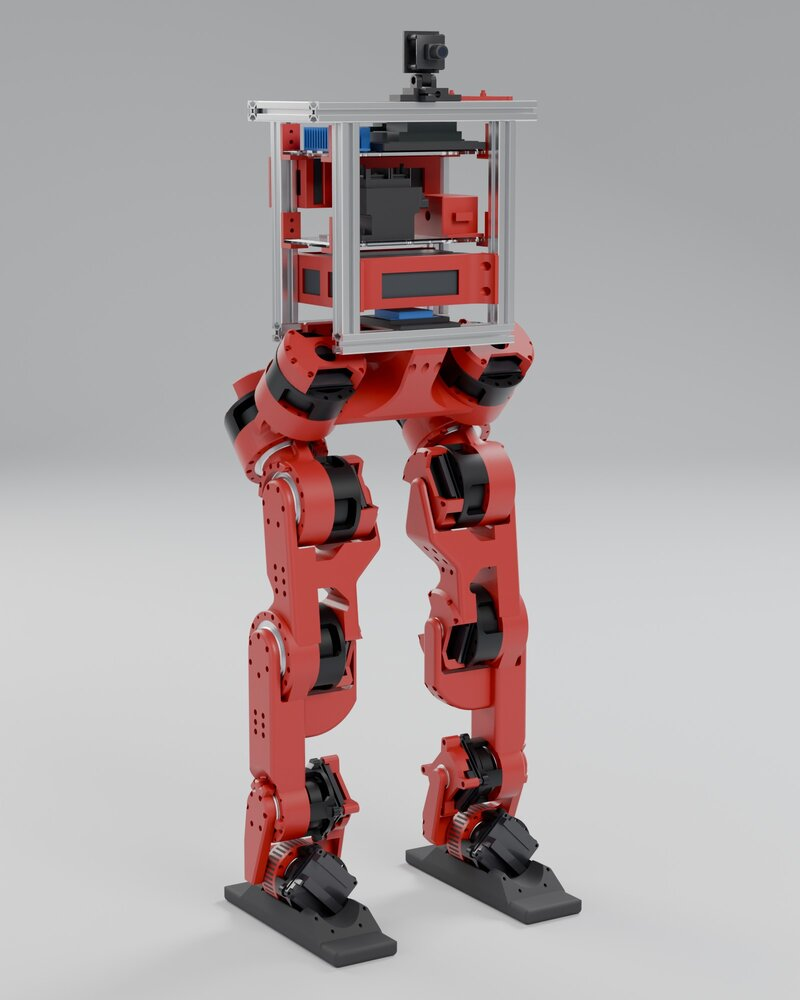
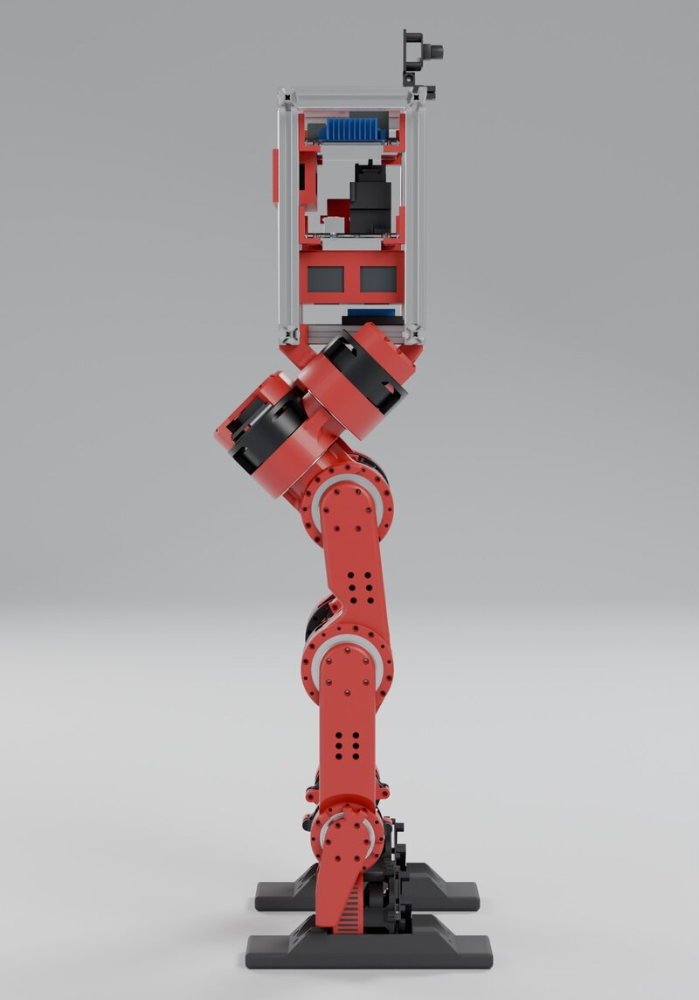
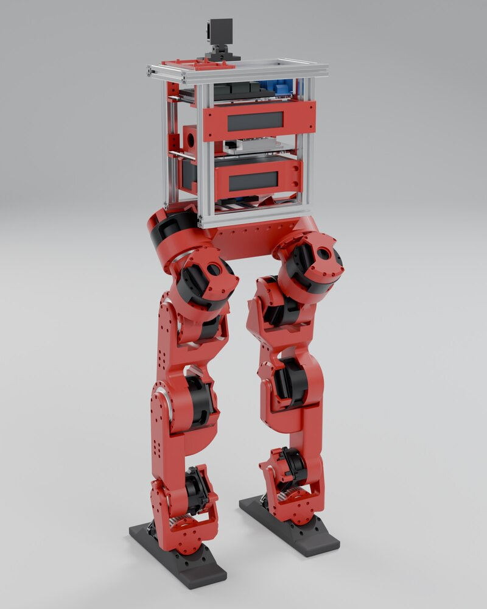
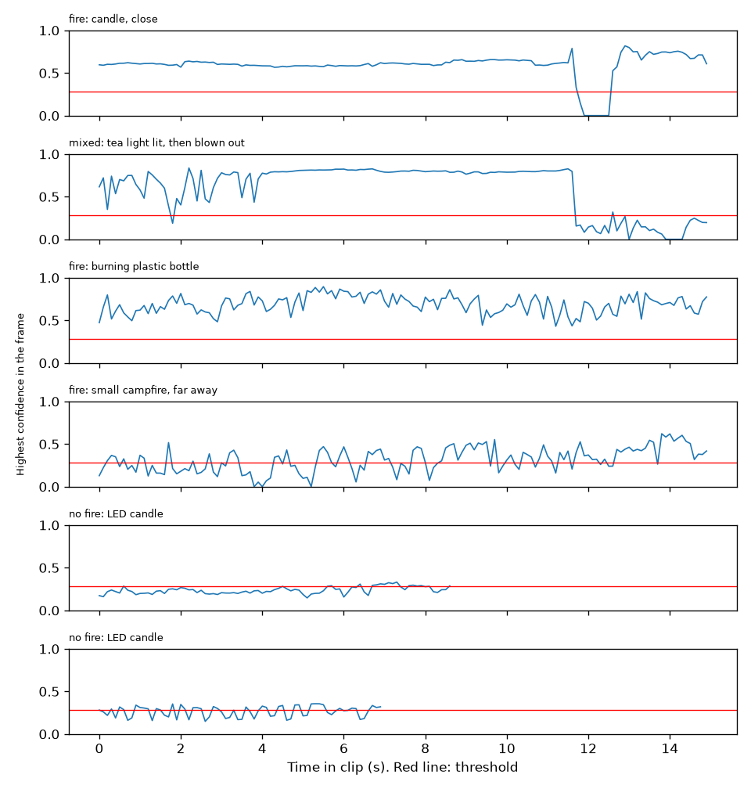

<div align="center">

<a href="https://www.snu.ac.kr"><picture>
  <source media="(prefers-color-scheme: dark)" srcset="docs/img/snu-dark.svg">
  
</picture></a>

# Sobang-I

**Our course prototype: a small humanoid that finds a candle fire, walks to it and sprays water on it.**

Team SOBANG · Seoul National University · ASMR 2026 · final demo on 10 December 2026

[](docs/board_setup.md)
[](pyproject.toml)
[](LICENSE)

[Design](docs/design.md) &nbsp;·&nbsp; [Run it on the robot](docs/board_setup.md)

<table>
  <tr>
    <td width="33%"></td>
    <td width="33%"></td>
    <td width="33%"></td>
  </tr>
  <tr>
    <td align="center"><sub>Front</sub></td>
    <td align="center"><sub>Side</sub></td>
    <td align="center"><sub>Rear</sub></td>
  </tr>
</table>

<sub>Blender renders of the full CAD, <a href="cad/SOBANG-I_Full_Assembly.step">cad/SOBANG-I_Full_Assembly.step</a>. The real robot is not complete yet. We placed the camera module by hand, because its STL files have no position.</sub>

</div>

## About

This repository holds the code, models and documents of our ASMR 2026 course project. We build a prototype and show it at the final demo. It is not a product.

The robot uses our own legs, inspired by the Berkeley Humanoid Lite, a small open-source biped. On top, we add a torso with the computer and the batteries. The camera and the water nozzle are fixed on the robot at a set angle, so the robot turns its whole body to aim. The water and the pump stay on a small trolley that a teammate pushes behind the robot. A thin hose goes from the trolley to the nozzle. A potentiometer on the trolley sets the pump speed by hand.

At the demo, the robot must find a candle, walk to it, aim and put it out.

## Current state

| Part | Status | Numbers |
|---|---|---|
| Fire detector | measured on board | YOLO11n in INT8 on the RK3566 NPU: 21 fps. Flame found in 267 of 267 frames of a candle video on a screen (11 Nov). mAP50 0.809 on 13 919 test images (laptop). |
| Leg drives over CAN | measured on laptop | All 12 drives answer. Direction and zero are set for 12 joints, and 11 joints move on command (13 Nov). |
| Walking | measured on board | `real_clamp12` (also `real_clamp9`, `real_clamp6`) walked on the real robot in a harness (25 Nov), with the 50 Hz Radxa loop and a torque clamp. Training environment and results: [sim/locomotion/results/real_walk.md](sim/locomotion/results/real_walk.md). |
| Aiming and full missions | tested in simulation | All fires out in 8 of 50 random missions, 37 of 102 fires out. |
| Water jet | tested in simulation | The model gives 9.6 m/s at the 1.0 mm nozzle, a reach of 2.7 to 5.1 m and 4.8 min of spray from a 2 L bag. |
| Water trolley | planned | 2 L bag, pump and battery on a pushed pole, a hose to the fixed nozzle. |
| Torso CAD for the trolley design | planned | The full robot CAD is in [`cad/`](cad/). The camera module is in pull request 7 and has no position in the assembly yet. |
| Real fire test | planned | |

## How it works

<picture>
  <source media="(prefers-color-scheme: dark)" srcset="docs/img/pipeline-dark.svg">
  
</picture>

1. **See.** [`robot/camera_node.py`](robot/camera_node.py) reads the Arducam B0201 at 640 × 480 and 15 fps. The lens is calibrated: f = 476 px, 80° horizontal view.
2. **Detect.** [`vision/detector.py`](vision/detector.py) runs YOLO11n at 416 × 320. On the board it uses the INT8 model on the NPU. On a laptop it uses the ONNX model on the CPU.
3. **Aim.** [`aim/run.py`](aim/run.py) puts the bottom of each box on the floor and follows the fire over time. It needs 3 detections in 0.6 s before it treats a box as a fire. At 10 Hz, it sends a walk speed and a turn rate that bring the robot to the fire and turn it to face the fire.
4. **Walk.** [`legs/run_policy.py`](legs/run_policy.py) runs the walking network at 25 Hz. It reads the IMU and the 12 joint angles, and it sends 12 joint targets over 2 CAN buses.
5. **Spray.** The nozzle points where the robot faces. The pump on the trolley is not controlled by the software. The potentiometer sets its speed.
6. **Check.** The robot watches the fire for 5 s. If a box does not get smaller after 15 s, the robot ignores it, because it is probably a lamp.

[`robot/launch.py`](robot/launch.py) starts all programs and stops all of them when one fails. The robot e-stop cuts the leg drives.

<details>
<summary><b>Test results</b></summary>

<br/>

The detector on real fire clips. Each line is the best confidence in one frame, and the red line is the threshold. The LED candles stay below it. The tea light drops below it when it goes out.



Sixteen random missions in the MuJoCo simulation. Grey is search and blue is approach. Green dots are fires that went out, red dots are fires still burning, and a black cross is a fall.


These missions used the old design with water tanks on the torso ([sim/mission](sim/mission/README.md)).

</details>

## Quick start

You need `git` and [uv](https://docs.astral.sh/uv/). These commands run on a laptop, without the robot.

```bash
git clone https://github.com/promaaa/firefighter-robot.git && cd firefighter-robot
uv sync --extra sim --extra dev                                    # Python 3.12 environment with MuJoCo
uv run --extra sim --extra dev pytest                              # robot software tests: aim, actuators, robot
uv run --extra sim --extra dev python sim/sim2sim/run.py --check   # the robot stands 5 s in MuJoCo
```

To run the real robot, follow [docs/board_setup.md](docs/board_setup.md): SSH, install, CAN and camera checks, leg calibration, then the walking policy on the gantry.

## Repository

| Path | Role |
|---|---|
| [docs](docs/README.md) | Design, wiring drawings, trolley |
| [docs/board_setup.md](docs/board_setup.md) | Step-by-step setup of the ROCK 3C and the first hardware tests |
| [robot](robot/README.md) | Launcher, camera node, pump, bench tests, board installer |
| [legs](legs/README.md) | CAN driver, calibration, IMU, walking policy loop, joint identification |
| [aim](aim/README.md) | Fire position, jet arc, mission states |
| [actuators](actuators/README.md) | Pan-tilt and pump node, walk command bridge |
| [vision](vision/README.md) | Fire detector: data, training, export, board models, camera tests |
| [sim](sim/README.md) | Robot models, missions, walking, water jet |
| [sim/locomotion](sim/locomotion/README.md), [policies](policies/README.md) | Walking policy training in Isaac Lab, and the trained policies |
| [ASMR_Actuator_Test](ASMR_Actuator_Test/README.md) | Leg actuator bench tests, drive setup records, sim-versus-real GUI |
| [cad](cad/README.md) | CAD files of the hardware team |

[CONTRIBUTING.md](CONTRIBUTING.md) says where to put new code and results.

## Team

- **Marc Duboc** ([@promaaa](https://github.com/promaaa)): software, vision.
- **오상준**: hardware.
- **Merwan Picout**: hardware.
- **권오성**: software.
- **김태환** ([@kth02](https://github.com/kth02)): hardware.
- **유동주**: hardware.
- **이철희** ([@poiuy45987](https://github.com/poiuy45987)): software.
- **이해우**: hardware.
- **이호영**: hardware, circuit engineering.
- **하홍준**: hardware.
- **허근영** ([@GeunYoung-Heo](https://github.com/GeunYoung-Heo)): software, control engineering, simulation.

Team SOBANG builds Sobang-I at Seoul National University for the ASMR 2026 course. *Sobang* (소방) means firefighting in Korean.

## License

Code: [MIT](LICENSE). CAD files and documents: [CC BY-SA 4.0](LICENSES/CC-BY-SA-4.0.txt). [vision/](vision/LICENSE): AGPL-3.0, because it uses Ultralytics YOLO. The Berkeley Humanoid Lite model and meshes are CC BY-SA 4.0. Please cite the Berkeley Humanoid Lite paper: Y. Chi et al., RSS 2025, [arXiv:2504.17249](https://arxiv.org/abs/2504.17249). The SNU emblem belongs to Seoul National University.
