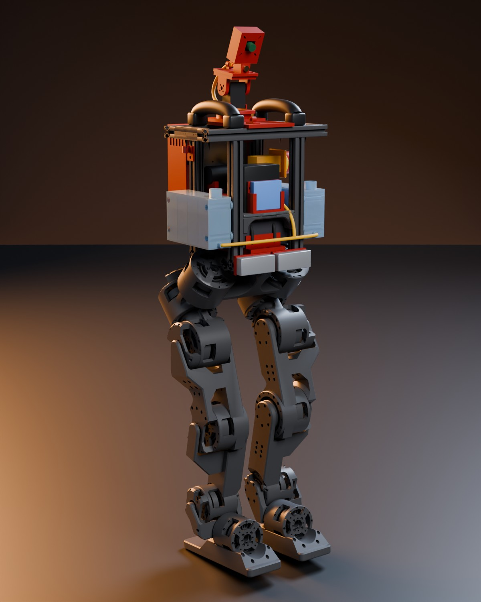

# Sobang-I · firefighting humanoid

<p align="center">
  
</p>

Sobang-I finds a small fire with its camera, walks to it and puts it out with a water jet. It is built on the legs of the open-source [Berkeley Humanoid Lite](https://github.com/HybridRobotics/Berkeley-Humanoid-Lite).

Team SOBANG · Seoul National University · ASMR 2026.

## Documentation

| Topic | Where |
|---|---|
| Plan, milestones, who does what next | [docs/plan](docs/plan/README.md) |
| Final design and print kit | [docs/design.md](docs/design.md), [cad/final/kit](cad/final/kit/README.md) |
| Electrical drawings and power-on tests | [docs/hardware/electrical.md](docs/hardware/electrical.md) |
| Water system | [docs/hardware/water.md](docs/hardware/water.md) |
| Robot software on the ROCK 3C | [robot](robot/README.md), [legs](legs/README.md), [aim](aim/README.md) |
| Fire detector | [vision](vision/README.md) |
| Simulations | [sim](sim/README.md) |

## Quick start on laptop simulation

You need `git` and [uv](https://docs.astral.sh/uv/). Run from the repository root:

```bash
git clone https://github.com/promaaa/firefighter-robot.git && cd firefighter-robot
scripts/fetch_bhl_assets.sh   # Berkeley Humanoid Lite model and meshes
uv sync --extra sim --extra dev
uv run --extra sim --extra dev pytest
```

## Run on the robot computer (ROCK 3C)

This is the hardware-team entry point. Detailed wiring and bring-up procedures are in [robot/README.md](robot/README.md) and [legs/README.md](legs/README.md).

### 1. Connect a laptop to the board by SSH

1. Connect the ROCK 3C to the router with an Ethernet cable and power it on. Connect the laptop to the same network. If a monitor and keyboard are available, connect them to the ROCK 3C.

2. Find the board's username and IP address:

   - **With a monitor and keyboard:** Open a terminal on the ROCK 3C and run:

     ```sh
     whoami  # Show the username
     ip a    # Show the IP address
     ```

     Use the IP address assigned to the network interface connected to the router.

   - **Without a monitor and keyboard:** Follow Radxa's [remote access guide](https://docs.radxa.com/en/rock3/rock3c/radxa-os/remote-access) to find the board's IP address. The default username is `radxa`, unless it has been changed.

3. On the laptop, open a terminal and connect to the ROCK 3C:

   ```sh
   ssh <username>@<board-ip-address>
   ```

### 2. Password

- Default login ID/PW: `radxa` / `radxa`

### 3. Download the code

```sh
sudo apt update
sudo apt install -y git
git clone https://github.com/promaaa/firefighter-robot.git
cd firefighter-robot
```

### 4. Identify and configure CAN and camera devices

After downloading the code on the ROCK 3C, connect the CAN adapters and camera, then edit `robot/config.toml`.

1. **CAN adapters:** List connected USB devices and CAN interfaces. Note the serial numbers of both CAN adapters:

   ```sh
   bash robot/setup/install.sh --list-usb
   ```

   Unplug the adapter connected to the right leg and run the command again. The serial that disappears is the right adapter; the one that remains is the left adapter. Reconnect it, then enter both serials under `[can]` in `robot/config.toml`:

   ```toml
   [can]
   left_serial = "<left CAN adapter serial>"
   right_serial = "<right CAN adapter serial>"
   ```

2. **Camera USB ID:** Find the camera in the same output and copy its `vendor:product` ID. If unclear, unplug and reconnect the camera and compare the output. Enter the ID under `[camera] usb` in `robot/config.toml`:

   ```toml
   [camera]
   usb = "<camera vendor:product>"
   ```

3. **Camera detector:** `detector` is a code-file path, not a USB ID. Leave `detector = ""` to select `vision/detector.py`, which uses `vision/models/fire_yolo11n_416x320.onnx` by default. Set a path only when intentionally selecting another detector.

### 5. Install the board setup

After editing `robot/config.toml`, set up the board environment and hardware configuration.

First, preview the planned changes:

```sh
bash robot/setup/install.sh --dry-run
```

Check the following items:

1. **`0. Check the computer`** — Confirm that the system is a ROCK 3C running `aarch64`.
2. **`3. uv and the Python environment (with the board extra: gpiod)`** — Confirm that the `uv sync` command includes `--extra board`.
3. **`4. udev rules`** — Confirm that the camera USB ID and both CAN adapter serial numbers appear in the rules. If any are missing, add them to `robot/config.toml` and run the dry run again.

If all the checks pass, run the installer and then reboot:

```sh
bash robot/setup/install.sh
sudo reboot
```

The installer configures board packages, CAN networking, device permissions, the IMU UART and systemd services. It creates the board Python environment with `uv sync --extra board`; MuJoCo and simulation extras are not required for hardware operation.

### 6. Check the board and policy

After reboot, SSH back into the board and change to the repository directory:
```sh
cd firefighter-robot
```

Run the board preflight and policy checks:
```sh
.venv/bin/python robot/bench.py preflight
.venv/bin/python legs/run_policy.py --check
```
Fix any FAIL items reported by preflight before continuing. The policy check verifies that the ONNX model loads; it does not connect to CAN or move motors.

### 7. Check CAN communication

With the CAN adapters and configured, powered drives connected, run these checks in order:

First, list the drives and check their encoder replies:
```sh
.venv/bin/python legs/bringup.py scan
```
Expect six drives and `300 of 300` encoder replies on each CAN bus.

Then check that CAN communication stays healthy during the policy-rate test:
```sh
.venv/bin/python robot/bench.py can
```
Both buses should show `ERROR-ACTIVE`, all 12 drives should respond, and encoder replies should keep up with the 25 Hz check.

Both commands only check communication; they do not move the motors. If a check reports a problem, fix it before continuing.

### 8. Calibrate the leg zero

With the robot supported on the gantry, run the one-time leg calibration. Follow the prompts to move each joint by hand to its calibration stop; press Ctrl+C after all joints have been recorded. This creates `legs/calibration.json` for this robot.

```sh
.venv/bin/python legs/bringup.py calibrate
```

Verify the calibration before continuing. Put the legs in the zero pose, run the check, move each joint by hand to its calibration stop again, then press Ctrl+C. Each stop error should be less than 3°; if the output reports `WRONG ZERO`, repeat the calibration and check.

```sh
.venv/bin/python legs/bringup.py check
```

### 9. Run the hardware test menu

Start the menu from the repository root:

```sh
.venv/bin/python robot/test_menu.py
```

Choose the desired test from the menu. It includes motor, camera/fire detector, pump, pan/tilt, IMU and e-stop guidance. The motor test requires the drives to already have the low test current limits (2 N·m at the joint). The repository CAN commands cannot read that setting, so run the motor test only if it is confirmed in the drive setup record; otherwise skip that option. For a leg motor test, suspend the robot from the gantry with the feet clear of the floor and keep the selected limb clear. Pan/tilt and pump tests can also move hardware or spray water; keep people and electronics clear of the spray area.

### 10. Test the walking policy on the gantry

The policy current limits for a 6 N·m joint torque limit are:

| Drive motors | ODrive `current_lim` |
|---|---:|
| 6512 hip and knee motors | 5.97 A |
| 5010 ankle motors | 4.78 A |

The repository's CAN commands cannot read the stored `current_lim` value. Confirm the configured values from the drive setup record; do not assume the 2 N·m motor-test limits are suitable for walking. A joint torque limit and a motor current limit are related but have different units: the current limit caps motor torque, and the gear ratio converts that to the joint torque limit. If the policy values are not documented, do not start the walking policy until they are confirmed.

After the checks and calibration pass, test the walking policy with the robot supported by the gantry and the area clear:

```sh
.venv/bin/python legs/run_policy.py --vx 0 --vy 0 --yaw 0 --seconds 10
```

## Licence

Code: [MIT](LICENSE). CAD files and documents: [CC BY-SA 4.0](LICENSES/CC-BY-SA-4.0.txt). [vision/](vision/LICENSE): AGPL-3.0, because it uses Ultralytics YOLO. The Berkeley Humanoid Lite model and meshes are CC BY-SA 4.0 and the renders show them. Please cite the Berkeley Humanoid Lite paper: Y. Chi et al., RSS 2025, [arXiv:2504.17249](https://arxiv.org/abs/2504.17249).
