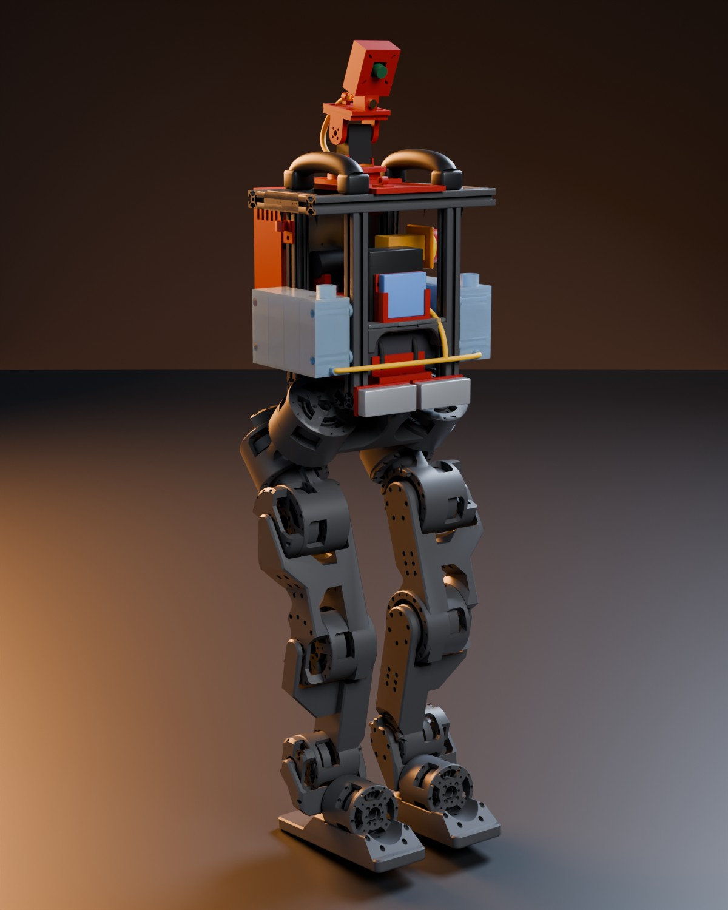

# Sobang-I · firefighting humanoid

<p align="center">
  
</p>

Sobang-I finds a small fire with its camera, walks to it and puts it out with a water jet. It is built on the legs of the open-source [Berkeley Humanoid Lite](https://github.com/HybridRobotics/Berkeley-Humanoid-Lite).

Team SOBANG · Seoul National University · ASMR 2026.

## Documentation

| Topic | Where |
|---|---|
| Plan, milestones, who does what next | [docs/plan](docs/plan/README.md) |
| Final design and print kit | [docs/design.md](docs/design.md), [cad/final/kit](cad/final/kit/README.md) |
| Electrical drawings and power-on tests | [docs/hardware/electrical.md](docs/hardware/electrical.md) |
| Water system | [docs/hardware/water.md](docs/hardware/water.md) |
| Robot software on the ROCK 3C | [robot](robot/README.md), [legs](legs/README.md), [aim](aim/README.md) |
| Fire detector | [vision](vision/README.md) |
| Simulations | [sim](sim/README.md) |

## Quick start

You need `git` and [uv](https://docs.astral.sh/uv/). Run from the repository root:

```bash
git clone https://github.com/promaaa/firefighter-robot.git && cd firefighter-robot
scripts/fetch_bhl_assets.sh   # Berkeley Humanoid Lite model and meshes
uv sync
uv run pytest
```

## Licence

Code: [MIT](LICENSE). CAD files and documents: [CC BY-SA 4.0](LICENSES/CC-BY-SA-4.0.txt). [vision/](vision/LICENSE): AGPL-3.0, because it uses Ultralytics YOLO. The Berkeley Humanoid Lite model and meshes are CC BY-SA 4.0 and the renders show them. Please cite the Berkeley Humanoid Lite paper: Y. Chi et al., RSS 2025, [arXiv:2504.17249](https://arxiv.org/abs/2504.17249).
