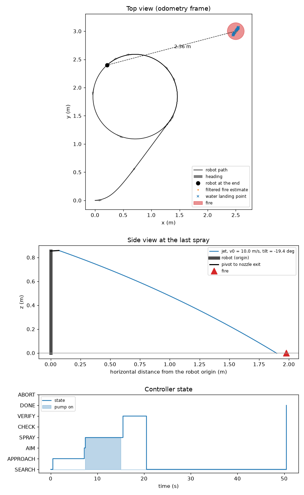

# Aim: from a fire detection to the water jet

This folder holds the code between the fire detector and the actuators.
It finds the fire position on the floor, aims the water jet, switches the water on and off, and tells the legs where to walk.
The core uses only Python and numpy. `robot/launch.py` runs it as `aim/run.py F2 --feedback`.

- **Assumed:** The F2 nozzle tip and camera poses on the tilt plate are estimates from the CAD (`geometry.py`).
- **Assumed:** The jet speed v0 = 10.0 m/s and the drag 0.11 1/m are model values ([docs/hardware/water.md](../docs/hardware/water.md)). The KLP02 jet is not measured. The jet test gives the real v0.
- **Not verified:** Nobody has tested that the walking policy steps back. The controller sends vx = -0.25 m/s when the fire is too close.

## Status

| Part | Status |
|---|---|
| Detector interface: one frame message per image | built, tested in simulation |
| Camera model, pan-tilt poses, fire localisation, target filter | built, tested in simulation |
| Ballistic aim, with and without air drag | built, tested in simulation |
| Aim solver: 0.35 ms with drag, 0.10 ms without (Intel i7-9700) | measured on laptop |
| Delay compensation: pose and pan-tilt angles at the image time | built, tested in simulation |
| Controller: search, approach, aim, spray, verify, interlocks | built, tested in simulation |
| `run.py` runtime over UDP | built, tested in simulation (`robot/sil.py`) |
| Calibration of v0, the nozzle zero and the camera | planned |

## Files

- `detection.py`: the `FireDetection` class.
- `geometry.py`: camera model, pan-tilt kinematics, localisation, target filter, and the robot configs in `CONCEPTS`.
- `ballistics.py`: jet model, aim solver, v0 helpers.
- `controller.py`: the state machine. It gives pan, tilt, pump on/off and a walk command.
- `run.py`: the runtime. It reads detections from UDP, runs the controller at 10 Hz and sends the commands.
- `sim_demo.py`: a small simulation with a plot. `send_test_detections.py`: a fake camera and detector for `run.py`.
- `test_aim.py`: the tests. `sim_demo_F2.png`: the demo plot.

`CONCEPTS["F2"]` is the current robot. `geometry.py` also keeps the earlier designs A, B, E and F1, because the tests and some simulations use them.

## How to run

Run all commands from the repository root.

1. Run the tests (41 tests on 2026-10-22):

```sh
uv run pytest aim -q
```

2. Run the demo. It writes the plot below.

```sh
uv run python aim/sim_demo.py F2 aim/sim_demo_F2.png
```

Result on 2026-10-22: the robot sees the fire, walks to it, sprays from 2 m, and the fire goes out after one spray.
Then the robot checks the fire for 5 s and searches for other fires for 30 s. It stops at DONE after 50.5 s.



3. Test `run.py` without the camera node. In a first terminal, start the runtime:

```sh
uv run python aim/run.py F2
```

4. In a second terminal, start the fake detector. It walks a simulated robot and puts a fire at (2.6, 0.8) m.

```sh
uv run python aim/send_test_detections.py F2 --v2
```

Result on 2026-10-22: the states went SEARCH, APPROACH, AIM, SPRAY, VERIFY, SEARCH and DONE. The pump was on for 6.3 s.
`robot/launch.py --sim` runs the same code with the real camera node and actuator node ([robot/README.md](../robot/README.md)).

## Detector interface

The camera node sends one frame message per camera image to UDP 5600, also when it sees no fire:

```json
{"timestamp": 12345.678, "camera": "rgb", "frame": true, "detections": [{"u": 331.5, "v": 298.0, "bbox": [310, 280, 352, 316], "confidence": 0.87}]}
```

Each detection has the fields of `FireDetection` (`detection.py`). It takes `timestamp` and `camera` from the frame.

| Field | Unit | Meaning |
|---|---|---|
| `timestamp` | s | time of the image, `time.monotonic()` on the robot computer |
| `camera` | | camera name in the robot config: `"rgb"` |
| `u`, `v` | px | fire point in the full camera image, 0 = left edge and top edge |
| `bbox` | px | box `(u_min, v_min, u_max, v_max)` |
| `confidence` | 0 to 1 | detector score |
| `max_temp_c`, `depth_m` | °C, m | optional. `depth_m` is the distance along the camera axis. |

- An empty list (`"detections": []`) means that this image has no fire. A late image does not count as an image without fire.
- `u`, `v` is the bottom centre of the box, where the fire touches the floor. `vision/detector.py` and the colour-threshold baseline both do this.
- `vision/detector.py` corrects the lens distortion when `vision/camera_b0201.json` exists. The camera model here is a pinhole.
- `run.py` rejects a timestamp in the future or more than 1 s old. It rejects a missing field, an unknown camera or a wrong type, and prints why.
- `run.py` ignores fields that it does not know. It also accepts the older format: one detection per line, nothing for an image without fire.

## Inputs and outputs of `run.py`

The ports come from `robot/config.toml` `[ports]` ([docs/architecture.md](../docs/architecture.md)).

- In: frame messages on UDP 5600, and the robot pose on UDP 5605: `{"timestamp", "x", "y", "yaw"}` in the odometry frame, with optional `"roll"` and `"pitch"`.
- In, with `--feedback`: the measured pan and tilt of `actuators/actuator_node.py` on UDP 5603, with their time `t`.
- Out: one JSON line per tick (10 Hz) on stdout and to UDP 5601 (actuator node), 5602 (legs) and 5606 (`launch.py`):

```json
{"t": 221944.019, "pan": 0.093, "tilt": -0.359, "pump_on": false, "vx": 0.0, "yaw_rate": 0.0, "state": "DONE"}
```

- Without a pose for 0.5 s, `run.py` integrates its own walk command (dead reckoning) and prints a warning.
- `--no-walk` keeps the pose at (0, 0, 0) for bench tests. The fire must then be 0.7 m to 2 m away and within 90 degrees of the front.
- Without `--feedback`, a mock actuator reaches each command at once. Feedback older than 0.5 s gives the commanded angles and a warning.
- `run.py` exits at DONE. It takes the camera size and field of view from `[camera]`, and `ControllerConfig` overrides from `[aim.controller]`.

## F2 geometry

Robot frame: x forward, y left, z up, in metres. The origin is the floor point under the BHL base link (pelvis centre).
Pan turns about z, positive to the left. Tilt is the elevation, positive up.

| Item | Value |
|---|---|
| Tilt pivot, on the pan axis | (-0.038, 0, 0.854) m: 63 mm above the torso top |
| Nozzle exit, tilting frame | (0.100, 0, 0.040) m, estimate. At pan 0 and tilt 0: (0.062, 0, 0.894) m |
| Camera (Arducam B0201), tilting frame | (0.112, -0.035, 0.056) m, 16 deg below the nozzle axis, estimate |
| Camera model | pinhole, 640 × 480, 97.1 deg horizontal field of view (f = 283 px) |
| Pan and tilt limits | -90 to 90 deg, -40 to 45 deg |

The pose can carry the torso roll and pitch from the IMU. The base rotation is `Rz(yaw) Ry(pitch) Rx(roll)`, and positive pitch tips the front down.
The camera and the nozzle then tilt about the base link, 0.64 m above the floor (`BASE_Z`, approximate). The localisation and the aim solver both use this tilt.

## Controller

`Controller.step()` runs once per tick and returns `Command(pan, tilt, pump_on, vx, yaw_rate, state)`.
The values below are the F2 values of `CONCEPTS["F2"]["controller"]`. The defaults are in `ControllerConfig` (`controller.py`).

| State | The robot does | Next state |
|---|---|---|
| SEARCH | Sweeps the pan ±80 deg, one cycle in 7 s. Stands still for the first 7 s, then walks a small circle (0.3 m/s, 0.4 rad/s). Tilt -6 deg. | APPROACH after 3 valid detections within 0.6 s. DONE after 30 s without a fire. |
| APPROACH | Walks an arc toward the fire at 0.3 m/s until it is 2 m away or closer and in range. Steps back at 0.25 m/s when the fire is too close. | AIM. SEARCH after 3 s without a detection. |
| AIM | Stands still and turns the pan-tilt to the aim angles | SPRAY when the nozzle is within 2 deg and all interlocks pass |
| SPRAY | Pump on. The aim point sweeps ±0.08 m along the line of sight. After the last detection, the pump can stay on for 4 s more. | VERIFY after 50 frames without the fire (3.3 s at 15 fps), or after 11 s |
| VERIFY | Pump off. Watches the sprayed fire for 5 s and holds the last commanded angles. | AIM when the fire shows again. SEARCH when it stays out. |
| DONE | Stands still and holds the last commanded angles | none |
| ABORT | Torso roll or pitch above 0.6 rad (a fall): pump off, stop, hold | none |

- DONE also comes after 30 sprays, after 240 s of mission time, and when the tanks are empty (107 s of pump time).
- After 15 s of pump time on one target, its box must be 10 % smaller than in the first 3 s. If not, the controller ignores that target (a lamp, a red object).
- The BHL policy does not turn on the spot. So each turn gets a forward speed of at least 0.3 m/s, and the robot never turns while it steps back.
- AIM, SPRAY and VERIFY never turn the body. The pan-tilt turns instead.
- With several fires, the controller tracks the fire nearest to its estimate. From AIM to VERIFY, another fire cannot take over the target.
- VERIFY and DONE hold the last commanded angles, never the measured angles. Otherwise a sagging servo would creep down to its limit.

The pump runs only when all these interlocks pass:

- The last valid detection is less than 0.5 s old (4.5 s in SPRAY). A valid detection has a confidence of 0.3 or more.
- The fire is 0.7 m to 4 m from the robot origin, and the aim solver says that the jet reaches it.
- The pan and tilt angles are within 2 deg of the aim.
- The torso roll and pitch are 15 deg or less and change by 30 deg/s or less. The last tilt event and the start are more than 2 s ago.

The geometry compensates a steady torso tilt, so a steady tilt does not stop the spray. The SIL test found about 5 deg nose-up while spraying.

## Localisation and ballistics

- The code follows the ray through the fire pixel to the floor, or to `depth_m` on the ray. It uses the pose and the angles at the image time.
- In the test, the image is 100 ms old and the pan moves at 0.45 rad/s. The fire estimate stays within 1 mm. Without the compensation, the error is 9 cm.
- A small Kalman filter averages the positions. It rejects a position more than 3 standard deviations away, and accepts the new one after 5 rejections.
- The jet is a projectile that leaves the nozzle at v0 along the nozzle axis. The solver takes the lower, flatter arc.
- With `drag > 0`, the model adds quadratic air drag: `dv/dt = -g - k |v| v`. The first call builds a table of jets in 73 ms.
- With v0 = 10.0 m/s and drag 0.11 1/m, the F2 jet reaches the floor 1.0 m to 6.4 m from the robot origin.
- The camera is 0.90 m above the floor. In the search pose, it sees the floor from 0.55 m.

## Calibration

These steps are planned.

### Jet speed v0

1. Run the jet test of `robot/bench.py pump` ([robot/README.md](../robot/README.md), step 8). It shoots level from a known height h.
2. The test computes `v0 = x * sqrt(g / (2 h))` from the landing distance x, for each of 3 shots, and prints the mean.
3. Put the value in `robot/config.toml` under `[aim.controller]` as `v0 = ...`.

This formula ignores the air drag, and a short, low shot keeps that error small.
To check the drag, shoot at 20 or 30 deg and compare the landing distance with `sim_demo.landing_point()`.
Change `drag` in `[aim.controller]` until the model gives the measured distance.

### Nozzle zero

1. Put a wall 1 m in front of the nozzle exit. Command pan 0 and tilt 0.
2. Run the pump for a short time and mark the spot where the jet hits the wall.
3. Compare the spot with the nozzle height minus the drop `g x^2 / (2 v0^2)`, where x is the distance to the wall.
4. Change the servo zeros in `robot/config.toml` until the spot is straight ahead and at the right height.

### Camera to nozzle (bore-sight)

1. Calibrate the camera with `vision/calibrate.py` ([vision/README.md](../vision/README.md)). Command pan 0 and tilt 0.
2. Put a small target at a known position in the robot frame, about 2 m away. Compute its expected pixel with `geometry.project()`.
3. Read the pixel where the camera sees the target.
4. Add `atan((u_seen - u_model) / fx)` to the camera `yaw` and `atan((v_seen - v_model) / fy)` to the camera `pitch` in `geometry.py`.
5. Repeat steps 2 to 4 until the error is below 2 pixels. Then spray at a target on the floor at 2 m and measure the miss.

## Open points

- The controller sprays one fire at a time. It does not plan the order of several fires or a path around obstacles.
- The robot does not walk while it sprays.
- The pose estimate has no leg odometry, so it drifts when the robot slips.
- v0 and the drag stay model values until the jet test on the robot.
- `run.py` keeps v0 fixed. In the model, the jet follows the motor bus voltage: v0 ≈ 10.0 m/s × (V / 22.2 V)^0.8. A full pack gives 11.0 m/s.

Licence: code MIT (root `LICENSE`), this document CC BY-SA 4.0.
