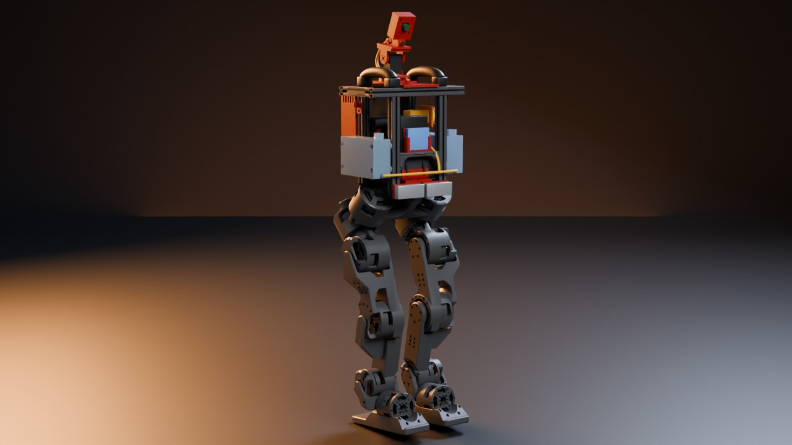
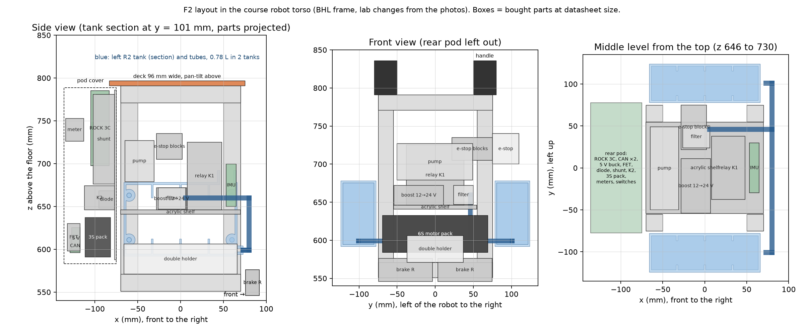

# Final design F2



This folder places every part of the course bill of materials (BOM) in the course robot torso.
Two R2 water tanks sit on the outer side faces of the torso posts.
The pan-tilt with two ST3215 servos carries the nozzle and the Arducam B0201 camera on top of the torso.
The print kit for the hardware team is in [`kit/`](kit/README.md).

Status: the CAD and the print kit are **built**. The checks are **tested in simulation**: they run on the CAD geometry and the Berkeley Humanoid Lite (BHL) meshes. Nothing here is printed or measured.

**Open:** The team uses the Kamoer KLP02 24 V pump with a DMC-101 controller. The CAD still has the DWP-385 gear pump of the earlier plan: the pump holder, the layout box, the checks and the mass use it. Kamoer does not publish the KLP02 size. We will redraw the holder when the KLP02 arrives and is measured.

**Open:** The 2 rear deck screws sit at x −60, y ±40. The pan base shelf (x −78 to 2, y −40 to 40) covers the inner half of each screw head. The checks do not model screw heads. Fix this in the CAD before you print the deck and the pan base.

**Assumed:** The course torso is the BHL torso. We checked this on 13 photos of the lab's prototype: the 2020 frame, the double top rails, the battery holder and the 45° hip actuators match. The lab made four changes. It removed the shoulder actuators and added two carry handles on the side top rails. It put the relay on the middle shelf (the BHL PC shelf). It put the computer at the top level and the e-stop on the left side.

**Assumed:** The battery positions are our proposal. The course has not published where its three batteries go.

**Not verified:** The handle size (about 30 mm thick, 45 mm high, inner gap about 100 mm) comes from the photos. Measure it on the robot before you print the deck.

**Not verified:** The robot needs the software knee limit of 1.4 rad. Over the full URDF knee range, the foot touches the rear end of a tank (0.1 mm).

## Terms

- **R2 tank:** a printed PETG water tank on the outer side face of the torso posts. `tank.py` builds it from `cad/torso_tank/body.py` with three fixes: the outlet hole, the screw tubes and the fill neck.
- **Rear pod:** a 2 mm aluminium plate on the rear posts, outside the frame. It carries the computer, the 3S pack and the small electronics, under a printed cover.
- **Robot frame:** x forward, y left, z up, in mm, feet on the floor. The top of the torso frame is at z = 791.

## Files

| File | What it does |
|---|---|
| `parts.json`, [`parts.md`](parts.md) | Size, mass, mounting and power facts of every BOM part, with the source of each value |
| `tank.py` | Builds the two R2 tanks and the 96 mm deck. Checks bed fit, closed meshes, the tank to torso mesh gap and the pan-tilt clearance to the handles. Writes `out_f2/r2.json`. |
| `kit.py` | Builds every printed part, the two cut drawings, `kit/print_sheet.md` and `kit/hardware.md`. Checks bed fit, closed meshes, walls, fit to the bought parts, solid collisions, torso clearance and the camera view. Writes `out_f2/kit.json`. |
| `layout.py` | Reads `kit.json`. Checks all gaps (parts, tanks, suction tubes, torso mesh, legs), sums the mass and writes `out_f2/layout.json`. `water` lumps both tanks in one box with the same mass, centre and inertia. |
| `views.py` | Draws the labelled section views `out_f2/layout_views.png` |
| `render.py` | Blender renders in `renders/`: `f2_*.jpg` and `turntable_f2.jpg` |
| `out_f2/` | In the repository: `r2.json`, `kit.json`, `layout.json`, `layout_views.png`, `tank_left.stl`, `tank_right.stl` and `deck_f1.stl`. The simulations in `sim/` read the meshes, `r2.json` and `layout.json`. The steps below also write STEP files, water shapes and reference shapes here. |

`sim/payload/models.py`, `sim/water/water.py` and `sim/mission/world.py` read `out_f2/`. When the layout changes, rebuild the simulation models with `uv run python sim/payload/models.py`.
`DESIGN=F1` in front of steps 1 to 4 builds the old design F1 (one tank inside the torso) into `out/` and `kit_f1/`. These folders are not in the repository.

## Run

Run all commands from the repository root, in this order: each step reads the output of the step before it.
The BHL meshes must be in `third_party/` (`scripts/fetch_bhl_assets.sh`).

1. Build the tanks and the deck (15 s):

```
uv run --project cad python cad/final/tank.py
```

2. Build the print kit and run its checks (30 s):

```
uv run --project cad --with matplotlib python cad/final/kit.py
```

3. Run the layout checks (3 to 5 min):

```
uv run --project cad python cad/final/layout.py
```

4. Draw the section views:

```
uv run --project cad --with matplotlib python cad/final/views.py
```

5. Render the stills with Blender (1 min on an RTX 3090). Add `turntable_f2` at the end for the turntable video. `TMPDIR` holds the video frames (150 MB). Add `F1_CPU=1` when the GPU is busy.

```
TMPDIR=$HOME/.cache PARTS_DIR=out_sts3215 blender -b --factory-startup -P cad/final/render.py -- third_party/berkeley-humanoid-lite-assets/data/robots/berkeley_humanoid/berkeley_humanoid_lite cad/final/renders
```

`kit.py` and `layout.py` stop with a list of failures. `layout.py` fails in these cases:

- two parts are less than 1 mm apart,
- a part or a suction tube is less than 1 mm from the torso mesh,
- a part, a tank or a tube is 10 mm or less from a leg, with the knee limited to 1.4 rad.

## Layout



Figure 1. Side view, front view and the middle level from the top. The boxes are the bought parts at datasheet size. Blue: tanks and suction tubes.

| Level | Parts | Mass |
|---|---|---|
| Bottom, z 545 to 633 | Two Zeee 6S packs (138 × 47 × 48.5 mm) side by side in the printed double holder, on the bottom rails, two straps. Two brake resistors on the front face of the front bottom rail. | 1.41 kg |
| Middle shelf, z 641 to 735 | 5 mm acrylic shelf (140 × 109 mm) on the PC shelf bracket bars. Relay K1 upright at the front, boost converter, e-stop contact blocks at the left (z 705 to 735), IMU upright in its mount at the front. | 0.67 kg |
| Middle shelf, rear | DWP-385 pump in its holder (axis z 703, head to the left), inline filter in front of it | 0.17 kg |
| Side faces, z 592 to 692 | Two R2 tanks, 0.781 L in total, 8 M5 × 55 screws. Suction tubes and tee in front of the front posts. | 1.25 kg full |
| Rear pod, x −136 to −75 | Plate: diode, shunt, ROCK 3C (upright, ports down), relay K2. Basket: 3S pack, 2 CANables, 5 V buck converter, MOSFET module of the old pump. Cover: 3 meters, 2 switches. | 1.18 kg |
| Top of the torso | Deck 96 mm wide, ST3215 pan-tilt, head with the B0201 camera and the nozzle | 0.52 kg |
| Wiring and clips | lumped at the torso centre (guess) | 0.32 kg |

The parts add 5.53 kg. We take the BHL battery (603 g) and the BHL computer (280 g) out of the BHL torso mass.
The robot weighs 15.99 kg with full tanks, 15.60 kg half full and 15.21 kg empty. The bare biped weighs 11.34 kg.
The simulation model (`sim/payload/models.py`) puts the centre of mass about 0.45 m above the floor with full tanks.

The water surface is at z 675.5 mm in full tanks. The tank floor is at z 594.5 mm. The pump inlet is at about z 700, so the pump lifts the water 25 to 105 mm.
The suction tube is about 0.20 m (left tank) or 0.29 m (right tank) to the filter, plus about 0.06 m to the pump. The nozzle tip is at z 892.5 mm with the tilt at 0.

## Checks (tested in simulation)

| Check | Result |
|---|---|
| Print pieces | All fit a 220 × 220 × 250 mm bed. All are one closed mesh. All walls are 2 mm or more. |
| Printed and bought parts as solids | No overlap |
| Parts against parts (boxes) | All gaps 1 mm or more. Smallest: filter to shelf 1.0 mm (it lies on it), filter to relay K1 2.0 mm, pump to e-stop blocks 3.0 mm. |
| Parts against the tanks | Smallest gap 7 mm (6S packs) |
| Tanks against the torso mesh | 2.5 mm. The pads touch the posts on purpose. |
| Parts against the torso mesh | Smallest gap 1.5 mm (6S packs, holder and pod spacers to the posts). Pump 5.0 mm. The Zeee straps come within 0.4 to 1.0 mm of the bracket tongues. A soft strap may touch. |
| Suction tubes | Smallest gap 4.0 mm (to the tank front face), 5.2 mm (to relay K1) |
| Legs, knee ≤ 1.4 rad | Smallest gap 43 mm (brake resistors). Holder 44 mm, tanks 47 mm, pod 48 mm. The pump, the e-stop and the suction tubes are never within 60 mm. |
| Legs, full URDF range | 0.1 to 0.2 mm (pack ends, holder, pod and both tanks): the foot folds up behind the hip at knee 2.4 rad. So F2 needs the knee limit of 1.4 rad. |
| Pan-tilt to the handles over a full pan turn | 12.0 mm |
| Nozzle tip in the camera image | 92° off the camera axis (below and behind the lens). The half view is 40°. |

The gap values change by about 0.1 mm from run to run, because the checks sample random points on the meshes.

## Open points

- Where does the course put its three batteries? If the layout of the teaching assistant (TA) differs, change the parameters in `kit.py` and run the steps again.
- The Korean shop link for the 6S pack is not the Zeee. It is a VEGA 5200 mAh pack (154 × 51 × 44 mm, 751 g). Print `holder_6s_vega` for it. It adds 0.3 kg. Its ends are 1 mm from the tank plates and from the bracket tongues.
- The tee joins both tanks. When the robot leans, one outlet can take air first. The jet then stops, with water still in the other tank. Test this on the bench (`docs/hardware/water.md`, test T8).
- The lab's e-stop bracket must move 50 mm up. We do not know how the lab fastened it.
- The course robot has no shoulder actuators. So the tanks could be taller than z 678. We kept the R2 size.
- The KLP02 is about 250 g. The CAD uses the DWP-385 (130 g). So the real robot will be about 0.12 kg heavier than 15.99 kg, plus the DMC-101. We did not rebuild the layout or the simulation models for this.
- The DMC-101 controller, the opto-isolator of the pump switch and the Waveshare servo adapter have no place in the CAD yet.
- The pump, the filter and the tube joints sit above the boost converter and near relay K1. Cover the relay terminals with boots or heat-shrink. Leak-test each tank for one hour before it goes on the robot.

## Licence

Code: MIT. CAD files, drawings and renders: CC BY-SA 4.0.
The renders show the BHL meshes (CC BY-SA 4.0). Credit the Berkeley Humanoid Lite team and use the same licence when you share them.
