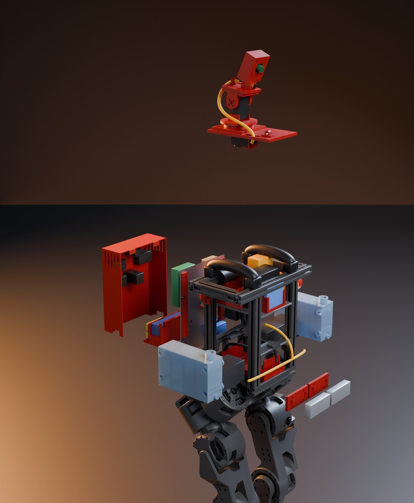
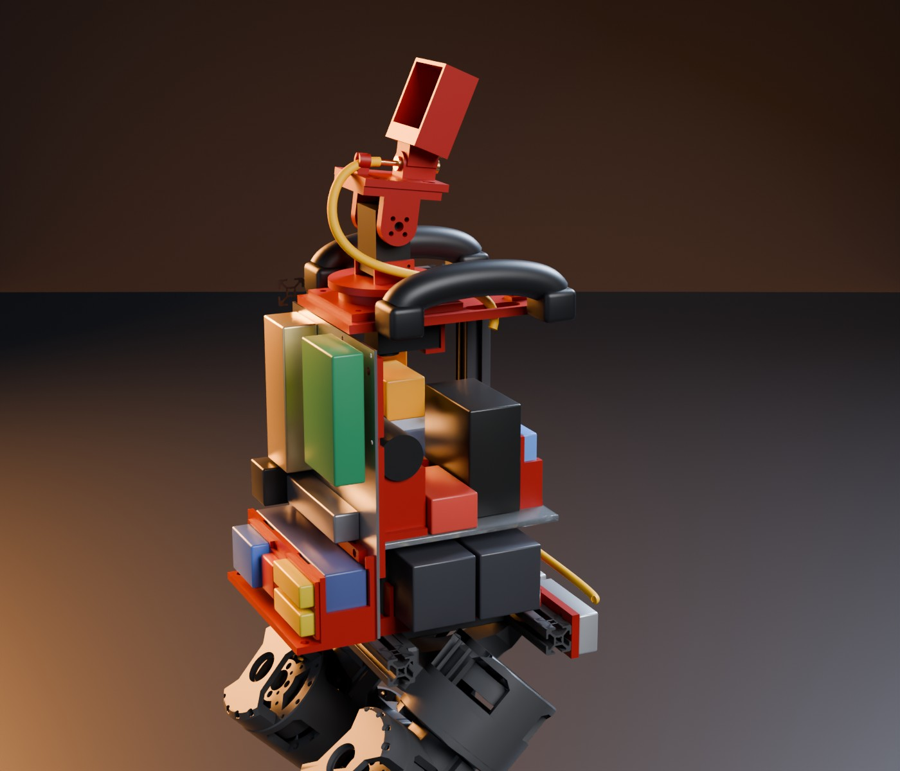
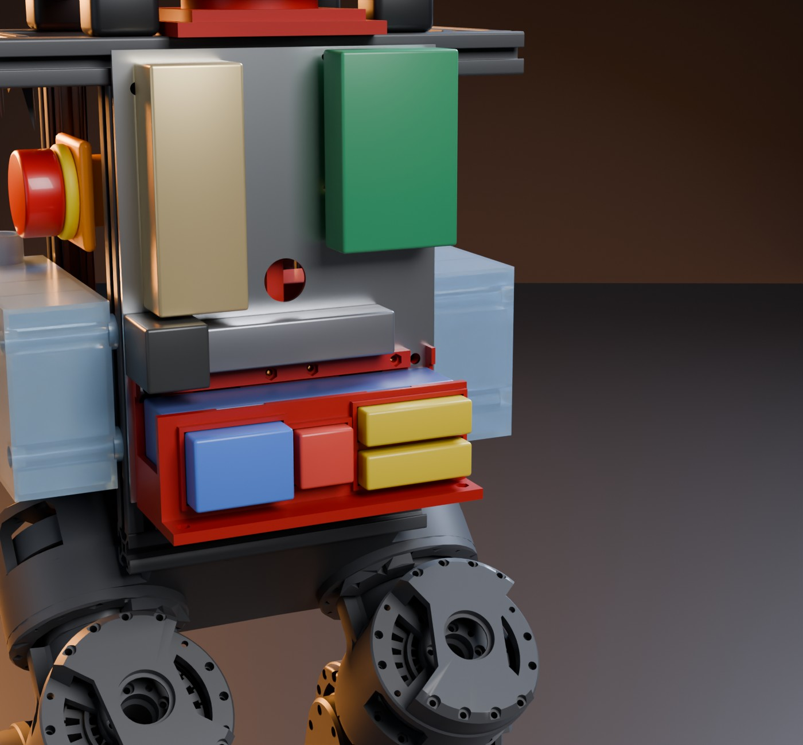
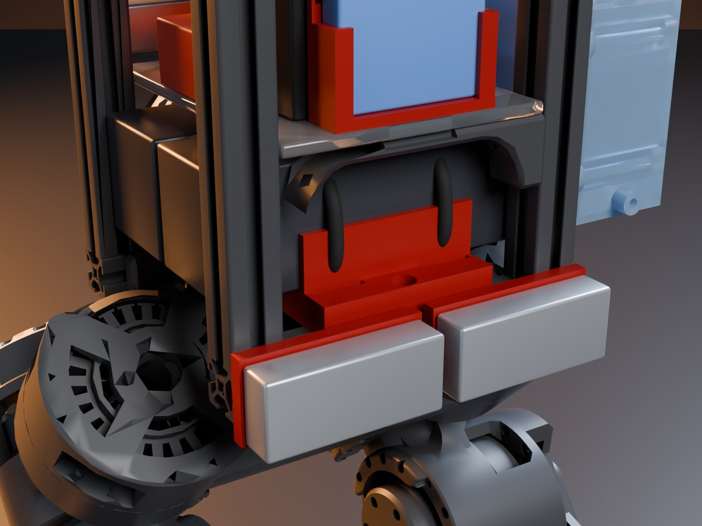
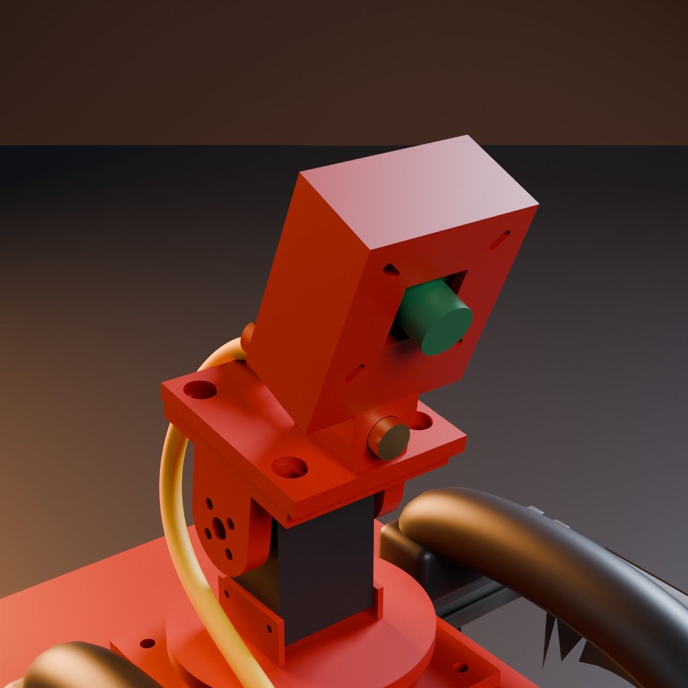

# F2 print kit

This folder is the print kit of the final design F2 for the hardware team.
It has the print files, the cut drawings, the print sheet, the hardware list and the assembly steps.

Status: the CAD is **built**. The checks are **tested in simulation** (CAD geometry, Berkeley Humanoid Lite (BHL) meshes, leg sweep). Nothing is printed, cut or measured.

`cad/final/kit.py` makes every file in this folder. Do not edit the files here by hand. Change the parameters in `kit.py` and run the steps of [`cad/final/README.md`](../README.md#run) again.

**Open:** The pump holder fits the DWP-385 gear pump of the earlier plan. The team now uses the Kamoer KLP02 24 V pump with a DMC-101 controller. Kamoer does not publish the KLP02 size. We will redraw the holder when the KLP02 arrives and is measured. Read the pump note before step 17.

**Open:** The 2 rear deck screws (x −60, y ±40) sit under the edge of the pan base shelf. The shelf covers the inner half of each screw head. The checks do not model screw heads. We will fix this in the CAD before the deck and the pan base are printed.

**Open:** The DMC-101 controller and the opto-isolator of the pump switch have no place in the CAD yet.

**Not verified:** These sizes come from listings, photos or guesses. Measure the parts before you print the part that holds them:

| Part | What to measure | Printed part | Parameter in `kit.py` |
|---|---|---|---|
| Kamoer KLP02 pump | size, ports, mounting holes (not published) | new pump holder (planned) | none yet |
| DMC-101 controller | size and holes (no datasheet yet) | none yet | none yet |
| Inline filter | length and diameter (32 × 26 × 25 mm assumed) | none (zip ties) | `FILTER2` |
| Brake resistor RH50C4R70J | hole pattern (39.7 × 21.4 mm assumed) | `resistor_mount_*` | `RES_HOLES` |
| B0201 camera | hole pattern (34 or 28 mm), lens holder size | `head_f1` | `CAM_PATTERNS`, `LENS_WIN` |
| Nozzle adapter (M6 female × 3 mm barb) | body width: the bore takes 10 mm round or 8 mm hex | `head_f1` | `NOZZLE_D` |
| IM10A IMU | case 59.5 × 49.5 × 11.7 mm with flanges | `imu_mount` | `IMU` |
| 6S packs | width: a bay takes up to 48.0 mm | `holder_6s_zeee` | `PACKS` |
| 3S pack | 138 × 46 × 30 mm | `pod_basket` | `L3, H3, D3` |
| CANable, buck converter | board outline | `pod_basket` (rail pockets) | `LIP_BOARDS` |
| Boost converter HAM5925 | hole pattern (59 × 29 mm assumed) | shelf drawing | `shelf_layout()` |
| Shunt | hole positions | pod plate drawing | `SHUNT_Y`, `SHUNT_Z` |

**Not verified:** The places come from the BHL torso mesh and 13 photos of the lab robot. Check these on the robot:

- the PC shelf bracket bars at z 641, with holes at x ±56, y ±9.8,
- the part on the rear face of the torso (x −74 to −64, z 587 to 627),
- the free outer side slots of the 4 posts at z 611 and z 663 (tank screws),
- the part inside the rear left post (x −69 to −51, y 46 to 52, z 653 to 689). The DWP-385 barbs pass 5 mm above it.

**Not verified:** The lab's e-stop bracket must move 50 mm up (step 28). We do not know how the lab fastened it.

**Not verified:** The robot needs the software knee limit of 1.4 rad. Over the full knee range, the foot touches the rear end of a tank.

**Assumed:** The packs are the Zeee 6S packs. If the teaching assistant (TA) buys the VEGA packs, print `holder_6s_vega` instead. It takes the same screws, and its straps sit at y ±37 mm. The VEGA pack ends are then 1 mm from the tank plates.

## Folder list

| Path | Content |
|---|---|
| `README.md` | this file: measurements, checks, assembly |
| [`print_sheet.md`](print_sheet.md) | each print piece: quantity, infill, orientation, supports, size, mass, time |
| [`hardware.md`](hardware.md) | screws, T-nuts, inserts, straps, fittings, with counts |
| `stl/` | 21 STL print pieces, robot frame, mm |
| `drawings/shelf_acrylic_5mm.dxf`, `.pdf`, `.png` | laser or drill drawing of the 5 mm acrylic shelf |
| `drawings/pod_plate_al2.dxf`, `.pdf`, `.png` | cut and drill drawing of the 2 mm aluminium pod plate |
| `../renders/` | `f2_exploded.jpg`, `f2_pod.jpg`, `f2_holder.jpg`, `f2_head.jpg`, `f2_front.jpg`, `f2_rear.jpg`, `f2_cutaway.jpg` |

`kit.py` also writes `step/`: STEP copies of the print pieces and of the pod plate, for other CAD programs. The repository does not keep them. Run `kit.py` to get them.

All STL files are in the robot frame: x forward, y left, z up, mm, feet on the floor. They stack on the robot without a transform. Turn each part to the orientation of `print_sheet.md` in the slicer.

## Checks (tested in simulation)

`kit.py` stops with an error when a check fails. `layout.py` then checks all parts together.

| Check | Rule | Result |
|---|---|---|
| Bed fit | 220 × 220 × 250 mm | All pieces fit. Largest: `pod_cover`, 63 × 155 × 206 mm. |
| Closed mesh | one closed body per STL | All pass. |
| Walls | thinnest wall ≥ 2 mm (ray scan, 0.5 % quantile) | All ≥ 2.0 mm. The tank tubs are 2.0 mm around the screw counterbores. The snap clips use their wall parameters (2.1 and 2.5 mm). |
| Fit to bought parts | pockets and holes from the datasheets | Bays 0.5 mm per side, IMU pocket 0.3 mm, ROCK 3C holes 58 × 49 mm, diode holes 80 mm, relay holes 63.5 × 26 mm. |
| Collisions, solids | printed parts, tank pieces, pan-tilt servos, bought parts, pump shape | No overlap above 1 mm³. |
| Torso mesh | ≥ 1 mm (straps ≥ 0.3 mm) | Smallest 1.5 mm (packs and spacers to the posts). Tanks 2.5 mm: the pads touch the posts on purpose. Pump 5.0 mm. Zeee straps 0.4 to 1.0 mm from the PC shelf bracket tongues. |
| Legs, knee ≤ 1.4 rad | ≥ 10 mm | Smallest 43 mm (brake resistors). Tanks 47 mm. The suction tubes, the pump and the e-stop never come within 60 mm. |
| Suction tubes | ≥ 1 mm from parts and frame | Smallest 4.0 mm (tube to the tank front face), 5.2 mm (tube to relay K1). |
| Nozzle in the image | nozzle tip outside the camera view | The tip is 92° off the camera axis, below and behind the lens. The half view is 40°. |

## Assembly

Use PETG for every print. Use the hardware of `hardware.md`.

### Bottom: brake resistors, battery holder, 6S packs

1. Take out the lab battery holder and its clamp block on the front bottom rail.
2. Press 4 M3 inserts into each resistor mount.
3. Drop 4 M5 T-nuts into the front slot of the front bottom rail.
4. Fasten the 2 resistor mounts to the front bottom rail with 4 M5 × 12 button head screws.
5. Fasten each brake resistor to its mount with 4 M3 × 8 screws.
6. Put heat-shrink tube on the 4 solder tags, because the 2 resistors are 7 mm apart.
7. Drop 4 M5 T-nuts into the top slots: 1 in the front rail, 1 in the rear rail, 2 in the centre rail.
8. Put the holder on the bottom rails, strap tunnels across the robot.
9. Fasten the holder with 4 M5 × 12 socket head screws.
10. Pull one 400 mm strap through each tunnel.
11. Slide the 6S packs into their bays. Close each strap with the overlap on the front side of the front pack.

### Middle: shelf, relay, boost converter, IMU, pump holder

12. Cut the acrylic shelf with `drawings/shelf_acrylic_5mm.dxf`.
13. Measure the boost converter board. Then drill its 4 holes.
14. Fasten relay K1 to the shelf with 2 M5 × 12 button head screws from below. Put the nuts on top.
15. Fasten the boost converter on 4 nylon spacers with 4 M3 × 10 screws.
16. Put the IMU mount foot on the shelf, over the 2 front bracket holes.

> **Pump note:** The pump holder (steps 17, 18, 23 and 24) fits the DWP-385 gear pump of the earlier plan.
> The team now uses the Kamoer KLP02 24 V pump with a DMC-101 controller.
> We will redraw the holder when the KLP02 arrives and is measured.
> Until then, skip steps 17, 18, 23, 24 and 27. Fasten the 2 rear shelf screws of step 20 without the holder.
> Kamoer gives a suction lift of 4 m or more, so the KLP02 can also sit above the water.

17. Put the pump holder base on the shelf, over the 2 rear bracket holes. The saddles go across the robot.
18. Push one 250 mm strap through the tunnel under the pump holder base.
19. Slide the shelf in from the front, between the front posts, onto the bracket bars.
20. Fasten the shelf with 4 M3 × 20 screws: 2 at the front through the IMU mount, 2 at the rear through the pump holder.
21. Put 1 mm foam tape on the back of the IMU.
22. Slide the IMU down into its mount. Close a zip tie through the 2 slots.

### Pump and filter

Steps 23, 24 and 27 are for the DWP-385. Read the pump note before step 17.

23. Put the pump on the 2 saddles. The pump head and barbs point to the left side of the robot.
24. Close the strap around the motor.
25. Put the inline filter on the shelf, between the pump head and relay K1. The arrow points to the pump.
26. Fasten the filter to the shelf with 2 zip ties.
27. Connect the filter outlet to the pump inlet with a short 3 × 6 mm tube.

### E-stop

28. Move the lab e-stop up on the left side face before you fit the left tank. Its centre goes to z 720, which is 50 mm higher than before. The head then sits 22 mm above the left tank.

### Tanks R2

29. Print the 4 tank pieces solid (100 % infill), so that the walls hold water.
30. Glue each plate on its tub with two-part epoxy.
31. Tap an M5 thread into the outlet hole of each tank. The outlet is the 4.2 mm hole in the boss on the front face, near the floor.
32. Screw an M5 × 3 mm barb into each outlet with PTFE tape.
33. Leak-test each tank for 1 hour (`docs/hardware/water.md`, test T1). If a tank leaks, coat the inside with thin epoxy and test it again.
34. Drop 2 M5 T-nuts into the outer side slot of each post, for z 611 and z 663: 8 T-nuts in total.
35. Hold the left tank on the left posts. The pads touch the posts. The fill neck is at the front top.
36. Fasten the tank with 4 M5 × 55 socket head screws and washers through the tubes in the tank.
37. Do steps 35 and 36 again for the right tank.
38. Run a 3 × 6 mm tube from each outlet barb forward, then across the front of the front posts, at the barb height.
39. Join the 2 tubes with the tee, 46 mm left of the centre of the robot.
40. Run one tube from the tee up the front of the robot to 15 mm above the shelf.
41. Run it back over the shelf, between relay K1 and the left front post, to the filter inlet.
42. Zip-tie the tubes to the front posts. Put a small zip tie on every barb joint.

### Top: deck, pan-tilt, head

The pan-tilt needs 2 ST3215 servos, one 6808-2RS bearing, 12 M3 horn screws and 8 M2 servo case screws (`hardware.md`).

43. Give the pan servo id 1 and the tilt servo id 2 (`actuators/README.md`, section "Set the servo ids").
44. Press 4 M4 nuts into the pockets on the top face of the deck.
45. Drop 4 M5 T-nuts into the top slots of the front and rear top rails, at y ±40 mm.
46. Fasten the deck to the front and rear top rails with 4 M5 × 12 socket head screws. First read the **Open** note about the rear deck screws at the top.
47. Fit the pan servo into the pan base, horn up and body forward. Fasten it with 2 M2 screws from above through the shelf and 2 M2 screws from below through the foot.
48. Press the 6808 bearing into its seat on the pan base shelf.
49. Lower the pan base onto the deck. The servo body goes through the deck window. Fasten the pan base with 4 M4 × 16 screws into the deck nuts.
50. Push the pan yoke hub into the inner ring of the bearing. Its boss reaches down to the pan servo horn.
51. Fasten the yoke to the pan servo horn with 4 M3 screws from the top of the turntable.
52. Put the tilt servo between the 2 yoke tabs, with its output horn on the left (+y). Fasten it with 2 M2 screws through each tab.
53. Press 4 M4 nuts into the pockets under the base of the tilt U.
54. Lower the tilt U over the tilt servo, with its arms outside the tabs. Fasten each arm to its servo horn with 4 M3 screws.
55. Fasten the head to the tilt U with 4 M4 × 12 button head screws.
56. Fasten the camera board behind the front window with 4 M2 × 8 screws and nuts, on the 34 or 28 mm slots.
57. Push the nozzle adapter into the head bore, barb to the rear. Tighten the M3 set screw.
58. Run the 3 × 6 mm tube from the pump outlet up through the deck slot. Pass it through the rear clip of the head onto the barb. Put the check valve in this tube, arrow toward the nozzle (`docs/hardware/water.md`).
59. Zip-tie 4 hose clips on the pan-tilt and the deck. Leave a loop for a full pan and tilt.
60. Run the servo and camera cables down through the deck slot. Leave a loop, so that the pan can turn.

### Rear pod

61. Cut and drill the pod plate with `drawings/pod_plate_al2.dxf`. Drill the 2 shunt holes from the shunt.
62. Fasten the diode with thermal paste, 2 M6 × 12 screws and nuts on the front side.
63. Fasten the shunt with 2 M5 × 10 screws and nuts.
64. Fasten 4 M2.5 standoffs with nuts on the front side. Fasten the ROCK 3C to them, ports down.
65. Stick relay K2 on the plate with foam tape. Close a zip tie through its 2 holes.
66. Put the rubber grommet into the 20 mm hole.
67. Drop 4 M5 T-nuts into the rear slots of the 2 rear posts.
68. Put the 2 spacers on the posts. Fasten the plate through them with 4 M5 × 12 button head screws.
69. Stick the 2 CANables and the buck converter into their rail pockets on the basket lip with foam tape. Leave the fourth pocket empty: it was for the switch of the old pump.
70. Put 4 M3 nuts into the band pockets of the basket. Fasten the basket with 4 M3 × 12 button head screws from the plate front.
71. Put the 3S pack into the basket. Close the 2 straps of 250 mm.
72. Put the 3 meters and the 2 switches into the cover.
73. Hang the cover on the plate top edge. Fasten its 2 tabs with 2 M3 × 10 screws from below.

### Cables and water

74. Fasten the frame clips with M5 × 8 screws into T-nuts where the cables run. The tanks cover the outer side faces of the posts from z 592 to 678.
75. Wire the robot as `docs/hardware/electrical.md` and `docs/hardware/harness.csv` say.
76. Set the software knee limit to 1.4 rad before the first walk.
77. Fill both tanks through their necks. Put a silicone stopper with a vent hole into each neck.

The tee joins the 2 tanks at the bottom. So the 2 water levels become equal when the robot stands still.

## Renders

The renders show the DWP-385 pump in its holder.

Figure 1. Exploded torso. The top and the shelf parts are lifted. The tanks and the 6S packs move out to the sides. The pod parts move back.

Figure 2. Torso cut open on the right side, right tank hidden. The pump lies on the rear of the shelf.

Figure 3. Rear pod with the cover pulled back.

Figure 4. Double battery holder with the straps, seen from the front right. The torso is cut open and the right tank is hidden.

Figure 5. Camera and nozzle head on the tilt U.

More views: [front](../renders/f2_front.jpg), [rear](../renders/f2_rear.jpg).

## Licence

The print files, the drawings and the renders are CC BY-SA 4.0.
The renders show the Berkeley Humanoid Lite meshes (CC BY-SA 4.0). Credit the Berkeley Humanoid Lite team and use the same licence when you share them.
