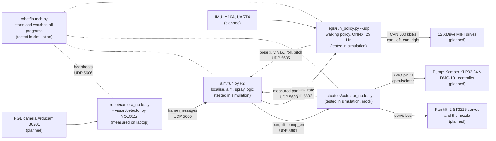

# System overview

This page shows how the software parts of the robot connect.
Each box has a status: built, tested in simulation, measured on laptop, measured on board, or planned.
All ports, devices, pins and limits are in one file: `robot/config.toml`. How to run the robot: [robot/README.md](../robot/README.md).

## Data between the parts

All ports are UDP on 127.0.0.1 (`robot/config.toml` `[ports]`). Each message is one JSON line, and each port has one reader.
`ROBOT_PORT_OFFSET=n` adds n to every port, so a test can run next to the robot software.

| Port | From | To | What | Where it is defined |
| --- | --- | --- | --- | --- |
| 5600 | camera node | `aim/run.py` | One frame message per image: `{"timestamp", "camera", "frame": true, "detections": [...]}`. An empty list means no fire. | `aim/detection.py`, `aim/README.md`, `robot/camera_node.py` |
| 5601 | `aim/run.py` | actuator node | `pan`, `tilt` (rad), `pump_on`, plus `vx`, `yaw_rate` and the state name | `aim/controller.py` (`Command`) |
| 5602 | `aim/run.py` | walking policy | `vx` (m/s), `yaw_rate` (rad/s). Zero after 0.5 s without a message. | `legs/run_policy.py`, `actuators/walk_bridge.py` |
| 5603 | actuator node | `aim/run.py` | Measured `pan` and `tilt` with their time `t`, the real pump output `water`, `estop` | `actuators/README.md` |
| 5604 | actuator node | fake camera (`--sim`) | The same as 5603 | `robot/fake_world.py` |
| 5605 | walking policy | `aim/run.py` | Pose estimate `{timestamp, x, y, yaw, roll, pitch}`: IMU angles, x and y from the commanded speed | `legs/run_policy.py` |
| 5606 | every program | `robot/launch.py` | Copies of the messages above, used as heartbeats. Also `launch.py --send ready` and `--send stop`. | `robot/README.md` |
| 5607 | fake legs | fake camera | The true torso pose, in `--sim` mode only | `robot/fake_world.py` |

Without a heartbeat, `launch.py` stops the robot: legs damping, pump off, pan-tilt hold ([robot/README.md](../robot/README.md), "Safety limits").

## Rules that all parts follow

- Robot frame: x forward, y left, z up, metres. The origin is the floor point under the BHL base link origin (pelvis centre).
- Timestamps use `time.monotonic()` on the robot computer.
- Angles are in radians. Pan is positive to the left. Tilt is positive up.
- All programs run on the robot computer, a Radxa ROCK 3C. The pump on/off line is a ROCK 3C GPIO (pin 11) with an opto-isolator.

## Modes

| Mode | What runs | Use |
| --- | --- | --- |
| `robot/launch.py --sim` | Fake CAN bus with the MuJoCo robot, mock servos and pump, synthetic camera | Software-in-the-loop tests on a laptop |
| `robot/launch.py --bench` | Real camera, pan-tilt and pump, no legs | Bench tests of aiming and spraying |
| `robot/launch.py --full` | Everything real | The robot |

Licence: this document is CC BY-SA 4.0.
