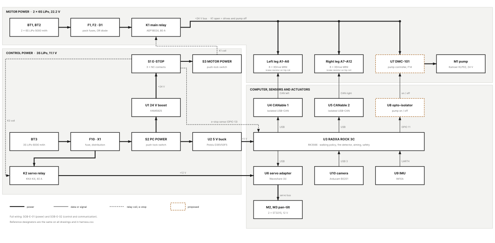
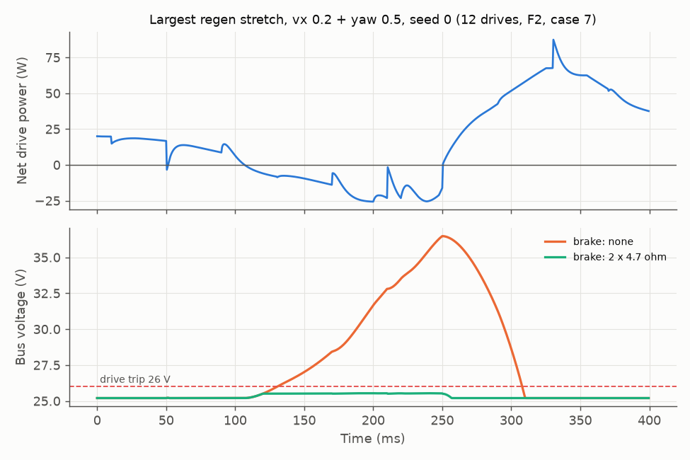

# Electrical design

Drawing set SOB-E, revision B (2026-10-22). Status: **planned**. Nothing is built or measured yet. The power numbers are **tested in simulation** (`power_calc.py` on the F2 robot model).



Figure 1. System overview. The full wiring is on two A3 sheets:

| Drawing | Content | File |
|---|---|---|
| SOB-E-01 | Power distribution: motor packs, fuses, OR diode, main relay, legs, brake resistors, pump; control pack, 5 V and 24 V converters, e-stop chain, servo relay | [SOB-E-01_power.svg](schematic/SOB-E-01_power.svg) |
| SOB-E-02 | Control and communication: ROCK 3C header and USB ports, two CAN buses with the 12 drives, camera, IMU, pan-tilt servos | [SOB-E-02_control.svg](schematic/SOB-E-02_control.svg) |
| both | A3 sheets for printing | [SOB-E_schematic.pdf](schematic/SOB-E_schematic.pdf) |
| every wire | ends, connector, gauge, colour, length, fuse, current | [harness.csv](harness.csv) |

The drawings use IEC 60617 symbols. Contacts are drawn at rest. A cross-reference such as `2/C6` means sheet 2, zone C6. Orange dashed parts are **proposed**: confirm them before you build them. [schematic/README.md](schematic/README.md) tells how to edit and rebuild the drawings.

## 1. Summary

| Item | Choice | Numbers |
|---|---|---|
| Motor bus | 2 × 6S packs → fuses F1, F2 → OR diode D1 → main relay K1 → fuses F3, F4 → two leg chains | walking 34 W mean, 191 W peak (simulation). Planning value 90 W. |
| Brake | 4.7 Ω 50 W resistor on the AUX terminal of the two hip-roll drives, with the drive over-voltage ramp 25.5 to 25.9 V | bus peak 25.6 V instead of 36.5 V, 1.15 W mean in the resistors |
| Pump | Kamoer KLP02 (24 V) with a DMC-101 controller, on the motor bus after K1, fuse F14 3 A | ≤ 12 W, about 0.5 A |
| Pump on/off | ROCK 3C pin 11 → opto-isolator U8 → DMC-101 control input (**proposed**) | the e-stop also cuts the pump through K1 |
| 5 V for the ROCK 3C | Pololu D36V50F5 (5.5 A) on header pins 2 and 4 | 1.6 A typical, 2.6 A peak |
| 24 V control | HAM5925 boost set to 24.0 V, current limit 0.5 A | K1 coil 176 mA, K2 coil about 0.1 A |
| E-stop | NC1 opens the K1 coil (drives and pump). NC2 opens the K2 coil (pan-tilt servos). NC3 is a sense line to pin 13. | |
| IMU | UART4 on pins 16 and 18 (`/dev/ttyS4`) | the 4 USB ports take the 4 USB devices |
| Fuses | 10 mini blade fuses, 32 V DC | section 6 |
| Battery time | 2 × 6S: 2 h (planning), 5.0 h (simulation, with the pump). 3S: 2.6 h. | section 3.3 |

## 2. Parts

The reference designators are the same on the drawings, in `harness.csv` and in the [order list](order_list.md).

| Ref | Part | Function |
|---|---|---|
| BT1, BT2 | Zeee 6S LiPo 5000 mAh, EC5 | motor packs (course BOM) |
| BT3 | 3S LiPo 6000 mAh, EC5 | computer, relay coils and servos (course BOM) |
| D1 | MBRT400100 dual Schottky, common cathode | joins the two 6S packs |
| K1 | Panasonic AEP18024, 80 A, 24 V coil | main relay: motor bus and pump |
| K2 | KKA-K4 automotive relay, 40 A, 24 V coil | e-stop cut of the 12 V servo feed |
| S1 | A20-E01P e-stop, 3 NC contact blocks | NC1 K1 coil, NC2 K2 coil, NC3 sense |
| S2, S3 | 12 V and 24 V push-lock switches (S3 with lamp H1) | PC POWER, MOTOR POWER |
| U1 | HAM5925 boost, 3S → 24.0 V | relay coil supply |
| U2 | Pololu D36V50F5 buck, 5 V 5.5 A | ROCK 3C and USB devices |
| U3 | Radxa ROCK 3C (RK3566) | robot computer |
| U4, U5 | CANable 2.0 Pro (isolated) | USB to CAN, one per leg |
| U6 | Waveshare Bus Servo Adapter (A) | USB to the ST3215 servo bus |
| U7 | DMC-101 DC pump controller | drives the pump (datasheet not available yet) |
| U8 | PC817-type opto-isolator | pump on/off across the two ground domains (**proposed**) |
| U9 | Hiwonder IM10A IMU | body attitude, UART4 |
| U10 | Arducam B0201 (IMX291, UVC) | fire camera |
| A1–A12 | XDrive MINI drives: 8 with M6C12 motors, 4 with MAD 5010 motors (ankles) | leg joints, node ids on sheet 2 |
| M1 | Kamoer KLP02, 24 V, self-priming diaphragm pump | water |
| M2, M3 | ST3215 servos, 12 V | pan and tilt |
| RB1, RB2 | RARA RH50C4R70J, 4.7 Ω 50 W | brake resistors |
| RS1, P1 | 100 A / 75 mV shunt with the HAV6001 V/A meter | motor bus meter |
| P2, P3 | HAV1625a ammeter, HAV1808 voltmeter | 3S meters |
| RV1 | 10D390K varistor | K1 coil suppression |
| D2 | SB560 Schottky | K2 coil flyback |
| R1, R7, R8 | 10 kΩ, 470 Ω, 10 kΩ | e-stop pull-up, opto LED, pump pull-down |
| F1–F14 | mini blade fuses | section 6 |
| X1 | Wago 221-413 lever connectors | 3S distribution |

## 3. Power

### 3.1 Rails

| Rail | Voltage | Source | Loads | Typical | Peak | Protection |
|---|---|---|---|---|---|---|
| Motor bus | 22.2–25.2 V | 2 × 6S through D1 and K1 | 12 XDrive MINI, pump | 34 W (simulation, walking). Planning: 90 W. Pump ≤ 12 W. | 191 W instant, 148 W over 20 ms | F1, F2 20 A (packs), F3, F4 20 A (legs), F14 3 A (pump) |
| 24 V control | 24.0 V | U1 boost from the switched 3S | K1 coil 176 mA, K2 coil about 0.1 A, lamp H1 | 0.29 A | 0.3 A | F12 2 A, boost current limit 0.5 A |
| 12 V | 10.5–12.6 V | 3S pack | U2, U1, and through K2: the two ST3215 | 1.83 A at 11.1 V (20.3 W) | 7.8 A at 10.5 V (both servos at stall) | F10 10 A, F11 5 A, F13 10 A |
| 5 V | 5.0 V | U2 buck | ROCK 3C, 2 CANables, camera, servo adapter (USB side) | 1.63 A | 2.62 A | buck current limit (5.5 A) |

The 5 V and 3S load details are in [power_calc.md](power_calc.md).

### 3.2 Motor bus power from the simulation

Tested in simulation: 40 runs of 20 s (4 commands × 10 seeds) on the F2 model. The drive model has K 20, D 2, 6 N·m, zero errors ±2° and 10 ms latency.

- Battery power while walking: 34 W mean, 41 W in the worst run. Standing: 21 W. Both include 18 W of drive standby (**Assumed:** 1.5 W per drive).
- Peak bus power: 191 W instant, 148 W over 20 ms. Peak into one drive: 107 W.
- Peak regenerated power of all 12 drives: 54 W. Peak of one drive: 79 W, which is 3.3 A back into the bus.
- **Not verified:** the simulation has no motor iron losses, no gearbox losses and no driver switching losses. The real power is higher.

The BHL paper gives about 30 min from one 6S 4000 mAh pack (88.8 Wh) for 22 actuators and a mini PC, about 178 W. Without the PC this is 7.4 W per actuator, so about 90 W for 12 actuators. We plan with 90 W until we measure.

### 3.3 Battery time

| Pack | Energy | Usable (80 %) | Load | Time |
|---|---|---|---|---|
| 2 × 6S 5000 mAh | 2 × 111 Wh | 178 Wh | 90 W planning / 35 W simulation (walking 34 W + pump 1.2 W mean) | 2.0 h / 5.0 h |
| 3S 6000 mAh | 66.6 Wh | 53 Wh | 20.3 W typical | 2.6 h |

- D1 joins the two packs. The pack with the higher voltage feeds the bus first. Charge both 6S packs to the same voltage before each session.
- Measure the real current with the P1 meter during the first walks, then update this table.

## 4. Brake resistor

### 4.1 Why the bus needs one

- D1 blocks any current back into the batteries.
- When the legs brake, the motors work as generators. Only the drive capacitors (about 6 mF in total) take this energy.
- Simulation (F2, worst case without standby power): without a brake, the bus rises from 25.2 V to 36.5 V. The drives trip at 26 V (`dc_bus_overvoltage_trip_level`).
- One regen event brings up to 2.0 J, up to 4.1 events per second. 6 mF takes only 0.12 J between 25.2 and 26.0 V. A bigger capacitor is not a solution: 2 J in 0.8 V needs about 100 mF.
- The P1 meter and the pump controller also need the bus to stay low: P1 takes at most 30 V on its supply.

### 4.2 Firmware behaviour

The course firmware is a modified MKS ODrive v0.5.1 ([course motor driver page](https://snu-srbl.github.io/asmr2026-docs/hardware/motor-driver/)).

- The XDrive MINI has a 2-pin screw terminal "+ AUX −" for a brake resistor.
- In 0.5.1, `brake_resistance = 0` turns the brake off. There is no `enable_brake_resistor` in 0.5.1.
- A drive with a resistor burns its own regen current only. The over-voltage ramp (`enable_dc_bus_overvoltage_ramp`) reacts to the bus voltage, so it also burns the regen of the other 11 drives. The ramp is active even when the motors are disarmed.
- The brake current counts in the drive bus current. The course sets `dc_max_positive_current = 12` A.

### 4.3 Options (tested in simulation, F2, ramp 25.5 to 25.9 V)

| Option | Peak bus (V) | Peak resistor power (W) | Mean resistor power (W) | Brake current per drive (A) | Verdict |
|---|---|---|---|---|---|
| None (course config) | 36.48 | 0 | 0 | - | the drives trip |
| 1 × 4.7 Ω on AUX + ramp | 25.63 | 45 | 1.14 | 5.2 | works, no redundancy |
| **2 × 4.7 Ω on AUX + ramp** | **25.57** | **47** | **1.15** | **5.2** | **chosen** |
| 2 × 2.2 Ω on AUX + ramp | 25.53 | 47 | 1.15 | 11.2 | the brake current alone nearly reaches the 12 A limit |
| 12 × own resistor, no ramp | 25.20 | 79 | 11.35 | - | works, but burns 10 times more energy and adds about 370 g to the legs |



Figure 2. The largest regen stretch of one F2 run. Without a brake, the bus passes 26 V for about 180 ms and reaches 36.5 V. With 2 × 4.7 Ω, it stays at 25.5 V.

### 4.4 Settings

1. Mount RB1 and RB2 on the pelvis frame with thermal paste.
2. Wire each one to the AUX terminal of one hip-roll drive with 18 AWG, 250 mm (W10, W11). The resistor has no polarity.
3. Measure each resistor at the drive end of the wire. Write the value + 0.05 Ω into `brake_resistance`.
4. On the two hip-roll drives (odrivetool, firmware 0.5.1):

```
odrv0.config.brake_resistance = 4.75
odrv0.config.enable_dc_bus_overvoltage_ramp = True
odrv0.config.dc_bus_overvoltage_ramp_start = 25.5
odrv0.config.dc_bus_overvoltage_ramp_end = 25.9
odrv0.config.dc_max_negative_current = -6.0
odrv0.save_configuration()
```

5. On the other 10 drives, keep `brake_resistance = 0`:

```
odrv0.config.dc_max_negative_current = -6.0
odrv0.save_configuration()
```

6. Keep `dc_bus_overvoltage_trip_level = 26` and `max_regen_current = 0`.

Why these values:

- One drive regenerates up to 3.3 A in the simulation. The course limit of −3 A would trip it. −6.0 A gives 80 % margin, and the shared brake takes the energy.
- 4.7 Ω limits the brake current to 0.95 × 25.9 V / 4.7 Ω = 5.2 A. With the motor current of the drive (up to 4.5 A), the total stays below 12 A.
- The ramp starts 0.3 V above a full pack (25.2 V), so the resistors stay cold while the robot stands.
- **Not verified:** the AUX current rating of the XDrive MINI. Makerbase publishes none. Its own example uses 2 Ω at up to 56 V.
- **Not verified:** the value of the brake resistor that ships with each XDrive MINI. Measure it. If it is 4 to 5 Ω, you do not need RB1 and RB2.

If trips still happen: the board is the 12–56 V version. You can raise `dc_bus_overvoltage_trip_level` to 28 V and `dc_bus_overvoltage_ramp_end` to 26.5 V. Ask the TA first, because this changes the course config.

## 5. Pump power and control

The team uses the Kamoer KLP02 in its 24 V version with a DMC-101 DC pump controller (decision of 2026-10-22).

- **Power:** U7 takes 24 V from the motor bus after K1, through F14 3 A (W32, 18 AWG). Its return goes to GND_M at the RS1 LOAD bolt.
- **Why the motor bus:** the e-stop already opens K1, so it cuts the pump with the drives. No new converter is needed. The 3S pack stays for the computer.
- **Control (proposed):** ROCK 3C pin 11 (GPIO3_A1) drives the LED of the opto-isolator U8 through R7 470 Ω. R8 10 kΩ holds pin 11 low, so the pump stays off while the board boots. The U8 output drives the DMC-101 control input.
- **Why an opto-isolator:** U7 sits on GND_M and the ROCK 3C sits on GND_3S. U8 keeps the two grounds apart (section 10).
- **Software:** `robot/pump.py` switches pin 11 on and off. It stops the pump after `max_spray_s` (12 s) and when the actuator node stops updating it (`robot/config.toml`, `[pump]`).

**Open:** We do not have the DMC-101 datasheet yet. Confirm these points before you wire the pump:

1. The control input of the DMC-101: on/off contact, logic level, or PWM. Change U8 and R7 to match.
2. The input voltage range of the DMC-101. The bus is 22.2–25.6 V with the brake resistors and up to 36.5 V without them.
3. The KLP02 variant: brushless or brushed. A brushed pump needs a flyback diode across its leads if the DMC-101 has none.
4. The start current of the pump. F14 is 3 A.

Alternative: feed the pump from the U1 boost on the 3S side. This needs a higher boost current limit and its own e-stop cut, so we do not use it.

## 6. Fuses and wires

Every wire, its fuse and its current are in `harness.csv`. `power_calc.py check` checks each row: the fuse is not larger than the wire rating, the continuous current is at most 80 % of the fuse, and the voltage drop is at most 3 % of the rail voltage.

| Fuse | Rating | Where | Wire | Holder |
|---|---|---|---|---|
| F1, F2 | 20 A | each 6S pack +, within 50 mm of the EC5 | 12 AWG | MTA 0100335 in-line, 30 A |
| F3, F4 | 20 A | each leg chain +, at K1 terminal 2 | 12 AWG | MTA 0100335 |
| F5 | 2 A | P1 voltage lead at the D1 cathode | 22 AWG | Coms BE151 |
| F10 | 10 A | 3S pack +, within 50 mm of the EC5 | 16 AWG | Coms BE151 |
| F11 | 5 A | 3S to S2 (computer and boost) | 22 AWG | Coms BE151 |
| F12 | 2 A | boost output to the e-stop chain | 22 AWG | Coms BE151 |
| F13 | 10 A | 12 V actuator node (after K2) to the servo adapter | 18 AWG | Coms BE151 |
| F14 | 3 A | motor bus (after K1) to the pump controller U7 | 18 AWG | Coms BE151 |

- All fuses are mini blade fuses (ATM / MINIVAL), 32 V DC. A full 6S pack has 25.2 V.
- The D1 cathode to K1 wire (W05) is 10 AWG, because both packs can feed it.
- In a leg short, the 20 A leg fuse blows before the pack fuses.

## 7. Connectors

| Connector | Where |
|---|---|
| EC5 | the 3 packs (course BOM) |
| XT60 | torso to each leg chain, female on the torso side (course BOM) |
| XT30 | inside the leg chains, as the course builds them |
| JST-GH 2-pin | CAN on each drive (course cable). The CANable side is a screw terminal. |
| Ring lugs 6 mm² (JOT 6-6, 6-8) | D1 screws, K1 studs, shunt bolts |
| DC plug 5.5 × 2.1 mm | servo adapter power |
| Dupont 1-pin | ROCK 3C header: power, pump control, e-stop sense, IMU |
| Yazaki 7283-1020 | K1 coil plug, ships with the relay |
| 6.3 mm female spade | K2 terminals |
| Wago 221-413 | 3S distribution (X1) and the 12 V actuator node |
| Pump and DMC-101 terminals | **Open:** follow the DMC-101 datasheet |

## 8. E-stop chain and relays

1. The 3S pack feeds U1 through F11 and the PC POWER switch S2.
2. U1 makes 24.0 V. Its output goes through F12 to S1 NC1, then to the MOTOR POWER switch S3, then to the K1 coil.
3. RV1 (10D390K) sits across the K1 coil. The S3 lamp H1 sits across the coil and shows "motor power on".
4. A jumper (W38) takes the 24 V from NC1 to NC2. NC2 feeds the K2 coil. D2 (SB560) sits across the K2 coil.
5. The K2 contact connects the 3S distribution to the 12 V actuator node. F13 feeds the servo adapter from this node.
6. NC3 opens the sense line on pin 13. `robot/pump.py` then keeps the pump off. Set `estop_chip = "/dev/gpiochip3"` in `robot/config.toml` when this wire is in place.

| Contact | Opens | Result |
|---|---|---|
| NC1 | K1 coil | the 12 drives and the pump lose power |
| NC2 | K2 coil | the pan-tilt servos lose power |
| NC3 | sense line, pin 13 goes high | `robot/pump.py` keeps the pump off |

- The walk and the aim loop stop because K1 and K2 cut the drives and the servos. `robot/launch.py` then sees the missing heartbeats and does the safe stop.
- K2 switches the servo current (up to 5.4 A at stall). The DC rating of the A20 contact blocks is not published, so the e-stop contacts carry only coil current.
- K2 also opens when S2 is off, because U1 then stops.
- No flyback diode on the K1 coil: Panasonic recommends a varistor, because a diode slows the release.
- Set the U1 under-voltage trimmer to 10.0 V input. Below 10 V the boost stops and K1 opens.
- When you release the e-stop, K1 and K2 close again (S3 stays on). The drives boot in idle and do not move until the software puts them in closed loop. The software must not restart the walk without an operator command.

Relay data: [Panasonic EP datasheet](https://www.tti.com/content/dam/tti-commons/supplier/panasonic/ecom/panasonic-ep-series-datasheet.pdf): coil 24 V ± 5 %, operate at 18 V or less, release at 2.0 V or more, 31.9 V maximum. The boost can give 35 V: never turn its trimmer up without a meter.

## 9. 5 V for the ROCK 3C

- The ROCK 3C takes 5 V only. 12 V destroys it.
- U2 is a Pololu D36V50F5: 5.5–50 V in, 5 V 5.5 A out, with reverse-voltage, over-current and over-temperature protection.
- W23: two 22 AWG pairs to header pins 2 and 4 (5 V) and 6 and 14 (GND). We use the header because we found no USB-C power lead in a Korean shop. Radxa supports 5 V on these pins.
- **Do not** plug a USB-C supply into the ROCK 3C while U2 feeds the header. Both feed the same 5 V rail.

## 10. Computer inputs and outputs

| Port | Device | Current |
|---|---|---|
| USB 3.0 host | camera U10 | 0.3 A max |
| USB 2.0 host 1 | CANable U4 (left leg) | about 0.1 A |
| USB 2.0 host 2 | CANable U5 (right leg) | about 0.1 A |
| USB 2.0 OTG, board switch at HOST | servo adapter U6 | about 0.05 A |
| UART4 (`/dev/ttyS4`), 3.3 V | IMU U9, 230400 baud. Pin 18 (TX) → IMU RX, IMU TX → pin 16 (RX). Power from pin 17, GND pin 20. | 12 mA |

| Header pin | Use |
|---|---|
| 1 | 3.3 V for the e-stop pull-up R1 |
| 2, 4 / 6, 14 | 5 V in / GND |
| 9, 11 | pump control: GND, GPIO3_A1 with the R8 pull-down |
| 13, 25 | e-stop sense: GPIO3_A2 with the R1 pull-up, GND |
| 16, 17, 18, 20 | IMU: UART4 RX, 3.3 V, UART4 TX, GND |

- The 4 USB devices take about 0.6 A. The board gives 2.8 A to its 4 ports in total.
- UART4 needs a device-tree overlay: enable "UART4-M1" in `rsetup`.
- Do not use pins 8 and 10: they carry the boot console.
- GPIO logic is 3.3 V, max 3.63 V. Never connect a 5 V signal to the header.
- **Not verified:** the gpiochip numbers (GPIO3_A1 = gpiochip3 line 1, GPIO3_A2 = gpiochip3 line 2). Check them with `gpiodetect` on the board.

## 11. Grounds

- The motor side (GND_M) and the 3S side (GND_3S) share no wire.
- K1 separates its coil (3S side) from its contacts (motor side). U8 separates the pump control.
- The CANables isolate CAN from USB. Connect the CAN GND terminal of each CANable to GND_M at the RS1 LOAD bolt (W40, W41).
- The XDrive USB port joins GND_M to the laptop when you configure a drive. Unplug the CANable USB first, or use a USB isolator.

## 12. Power-on test procedure

Status: planned. Do the steps in this order. Stop at the first step that fails and fix the fault. Write each value in the data sheet (12.8).

Tools: multimeter, a 10 Ω 10 W resistor, a bench supply with a current limit (0–30 V, 3 A or more), a LiPo charger and bag, and a class ABC or CO2 extinguisher within reach.

### 12.1 No power: visual and continuity checks

1. Unplug the three packs. Pull all fuses.
2. Compare every wire with `harness.csv`: ends, gauge, colour. Tick each row.
3. Pull each crimp and ferrule by hand. A good crimp does not move.
4. Measure from + to − at each robot-side EC5. Pass: more than 1 kΩ.
5. Measure each wire end to end. Pass: less than 0.1 Ω.
6. Measure from the RS1 BATT bolt (GND_M) to the X1 − (GND_3S). Pass: open, more than 1 MΩ.
7. Measure RB1 and RB2 at the drive AUX terminals. Pass: 4.7 Ω ± 10 %. Write the values down.
8. Check D1 in diode mode. Pass: A1 → K and A2 → K read 0.15 to 0.4 V. K → A1 and K → A2 read open.
9. Measure the K1 coil at its plug. Pass: 136 Ω ± 10 %.
10. Measure K1 terminal 1 to terminal 2. Pass: open.
11. Press the e-stop. Measure NC1, NC2 and NC3. Pass: open when pressed, below 1 Ω when released.

### 12.2 Polarity

1. Mark the + side of every EC5, XT60 and DC plug with red tape.
2. Measure each pack at its own plug. Pass: 6S 22.2 to 25.2 V, 3S 11.1 to 12.6 V.
3. **Reversed input destroys U1 and U7.** Check their + and − leads twice before the first power-on.

### 12.3 3S side on the bench supply

1. Set the bench supply to 11.1 V and 0.5 A. Switch its output off.
2. Connect it to the 3S EC5 (W20). Insert F10 and F11 only.
3. Switch the supply on. S2 is off. Pass: below 0.05 A.
4. Leave the ROCK 3C unplugged. Switch S2 on. Measure the U2 output. Pass: 4.85 to 5.20 V.
5. Unplug the K1 coil. Measure the U1 output. Turn its voltage trimmer to 24.0 V ± 0.2 V.
6. Put the 10 Ω resistor and the meter (current range) across the U1 output. Turn its current trimmer to 0.50 A. Remove the resistor.
7. Turn the under-voltage trimmer so that U1 stops at 10.0 V input. Check it by lowering the bench supply.
8. Switch the supply off. Raise the limit to 3 A. Plug in the ROCK 3C header leads (W23). Switch on. Pass: the board boots. The supply shows 0.5 to 1.5 A.
9. Run a CPU load on the board. Measure between header pins 2 and 6. Pass: 4.8 V or more.
10. Set the supply to 10.5 V, then 12.6 V. Pass: the board keeps running.

### 12.4 E-stop and relays (bench supply, no 6S pack)

1. Insert F12. Plug in the K1 and K2 coils. Release the e-stop. S3 is off. Pass: K1 stays open. K2 closes when S2 is on.
2. Switch S3 on. Pass: K1 clicks, H1 lights, the supply current rises by about 0.45 A.
3. Measure the K1 coil voltage. Pass: 22.8 to 25.2 V.
4. Measure K1 terminal 1 to terminal 2. Pass: below 0.01 Ω.
5. Press the e-stop. Pass: K1 and K2 open at once and H1 goes out. The 12 V actuator node reads 0 V.
6. Release the e-stop. K1 and K2 close again (section 8).
7. Switch S2 off. Pass: K1 and K2 open.
8. Set the supply to 9.5 V with S2 and S3 on. Pass: K1 opens.
9. Read the e-stop sense on the ROCK 3C: `gpioget gpiochip3 2`. Pass: 0 released, 1 pressed. Pull the W34 lead off. Pass: 1.

### 12.5 Pan-tilt (bench supply)

1. Insert F13. Plug in the servo adapter. Run `uv run python actuators/st3215.py --list`. Pass: two servos answer.
2. Press the e-stop. Pass: the servos go limp and stop answering.

### 12.6 Motor side: one 6S pack

1. Charge both 6S packs to storage voltage (22.8 V) for the first tests.
2. Insert F1 only. Plug in pack A. S3 is off. Pass: P1 shows about 22.5 V. K1 is open.
3. Measure the voltage at the left XT60. Pass: 0 V.
4. Insert F3 and F4. Plug in the leg chains. Switch S3 on. Pass: K1 clicks, the drive LEDs light, P1 shows the idle current (about 0.8 A). Write it down.
5. Run `uv run python legs/bringup.py scan`. Pass: 12 drives answer, and `vbus_voltage` is within 0.3 V of the meter.
6. Press the e-stop. Pass: K1 opens and all drives lose power.
7. Insert F2. Plug in pack B. Pass: the P1 voltage changes by less than 0.3 V.

### 12.7 Pump (after the DMC-101 wiring is confirmed)

1. With the board off, measure pin 11 to GND. Pass: about 10 kΩ (R8).
2. Fill the tanks. Insert F14. Close K1 (S3 on). Boot the board. Pass: the pump stays off during the whole boot.
3. Run `gpioset gpiochip3 1=1` for 2 s. Pass: the pump runs, P1 shows 0.3 to 0.6 A more. If the pump runs at 0 and stops at 1, the input is active-low: set `active_low = true` in `robot/config.toml`.
4. Press the e-stop. Set pin 11 high again. Pass: the pump does not run.

### 12.8 Brake test (legs hanging, one 6S pack)

1. Set the brake settings of section 4.4 on all 12 drives. Save. Reboot the drives.
2. Hang the robot. Start the hold test of `legs/bringup.py` at 6 N·m.
3. Push one shank fast toward the hold pose by hand and let go. Do it 10 times.
4. Pass: no drive trips. `dump_errors` shows no DC_BUS_OVER_VOLTAGE and no DC_BUS_OVER_REGEN_CURRENT.
5. After 2 min of leg motion, touch the resistor housings. Pass: warm at most (below 50 °C).
6. Charge pack A full (25.2 V). Repeat steps 3 and 4.

### 12.9 Data sheet

| Step | Value | Pass range | Measured | OK? |
|---|---|---|---|---|
| 12.1.6 | GND_M to GND_3S | open | | |
| 12.1.7 | RB1, RB2 | 4.7 Ω ± 10 % | | |
| 12.1.9 | K1 coil | 136 Ω ± 10 % | | |
| 12.3.4 | U2 output, no load | 4.85–5.20 V | | |
| 12.3.5 | U1 output | 24.0 ± 0.2 V | | |
| 12.3.9 | 5 V at the header, CPU load | ≥ 4.8 V | | |
| 12.4.2 | 3S current rise with K1 on | about 0.45 A | | |
| 12.4.3 | K1 coil voltage | 22.8–25.2 V | | |
| 12.4.5 | 12 V actuator node, e-stop pressed | 0 V | | |
| 12.4.8 | K1 at 9.5 V input | open | | |
| 12.6.4 | 6S idle current, 12 drives | about 0.8 A | | |
| 12.7.3 | pump current at 24 V | 0.3–0.6 A | | |
| 12.8.4 | highest `vbus_voltage` in the push test | below 26 V | | |

## 13. Open points

- The DMC-101 datasheet: control input, voltage range, terminals (section 5).
- No precharge circuit for the motor bus. K1 closes onto about 6 mF. The inrush rating of the AEP18024 is not checked.
- The drive node ids on sheet 2 follow `legs/robot.py`. Set the same ids in the drives, or change the table in `legs/robot.py`.
- The AUX current rating and the shipped brake resistor value of the XDrive MINI (section 4.4).
- **Assumed:** the S2 switch carries only the computer and U1 (2 A at most). Its contact rating is not published.

## 14. Sources

- Course docs, motor driver and actuator pages: https://snu-srbl.github.io/asmr2026-docs/hardware/motor-driver/
- Course drive config: https://github.com/omletkang/xdrive-mini-fw-instant-start/blob/main/xdrive_config.txt
- Makerbase XDrive MINI wiring and parameters: https://makerbase3d.com/wp-content/uploads/2024/08/XDrive-11.png, https://makerbase3d.com/wp-content/uploads/2024/08/XDrive-10.png
- ODrive 0.5.6 docs and changelog: https://docs.odriverobotics.com/v/0.5.6/getting-started.html, https://github.com/odriverobotics/ODrive/blob/master/CHANGELOG.md
- Panasonic EP relay datasheet: https://www.tti.com/content/dam/tti-commons/supplier/panasonic/ecom/panasonic-ep-series-datasheet.pdf
- HAM5925 listing: https://www.icbanq.com/P017179148
- Radxa ROCK 3C header: https://docs.radxa.com/en/rock3/rock3c/hardware-design/hardware-interface
- Pololu D36V50F5: https://www.pololu.com/product/4091
- Kamoer KLP02 parameters: https://www.kamoer.com/us/product/params.html?id=3006
- Wire ratings: https://www.powerstream.com/Wire_Size.htm
- BHL paper: https://arxiv.org/abs/2504.17249
