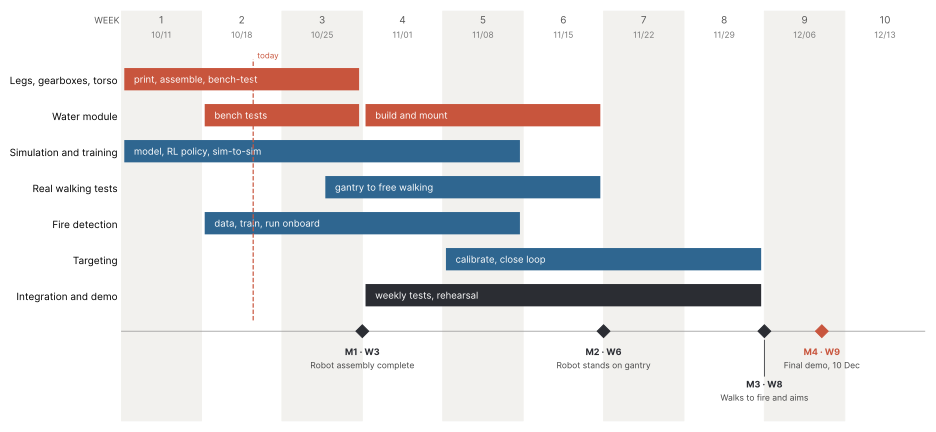

# Project plan

Goal: a legs-only humanoid (the course Berkeley Humanoid Lite biped, final design F2) finds a small fire with its camera, walks to it, aims a water jet with its pan-tilt and puts the fire out. A person at the e-stop can stop it at any time.

Final demo: **10 December 2026**. Plan of record: the team schedule board below. Review this page at every weekly meeting.

**Assumed:** the demo fire is a small tray fire (paper or wood, 10 to 30 cm) or a group of candles, on a fireproof tray, with an extinguisher and a person at the e-stop. Ask the TA which fire is allowed.

## Schedule and milestones

| Milestone | Week | Date | Pass criterion |
|---|---|---|---|
| M1 Robot assembly complete | W3 | 31 Oct | All 12 actuators are bench-tested. Legs and torso are assembled. All 12 drives answer on CAN with the robot hanging. |
| M2 Robot stands on gantry | W6 | 21 Nov | The robot stands for 60 s under the gantry with the walking policy, then walks on the gantry. Bus voltage stays under 26 V. |
| M3 Walks to fire and aims | W8 | 5 Dec | The robot sees a real fire, walks to it, aims and sprays. Three missions out of five succeed. |
| M4 Final demo | W9 | 10 Dec | |

`gantt.py` draws the chart: `uv run python docs/plan/gantt.py`.

## Workstreams and next tasks

Each workstream has one owner (see the team proposal). The links lead to the instructions.

| Workstream | State on 22 Oct | Next tasks |
|---|---|---|
| 3D printing and assembly | Pilot actuator assembled. Printing the 12 actuator modules (8 × 6512, 4 × 5010). | Print the F2 torso kit: 21 pieces, about 62 h ([print sheet](../../cad/final/kit/print_sheet.md)). Assemble it ([kit guide](../../cad/final/kit/README.md)). |
| Gearboxes and legs | Waiting for fasteners and parts. | Assemble and bench-test each actuator. Drive setup, CAN scan, zeroing, direction check, hanging joint test ([legs/README.md](../../legs/README.md)). |
| Torso | F2 layout and print kit built. | Measure the handles and the shelf on the robot before printing the deck. Mount the R2 tanks: 8 M5 × 55 screws, 32 M5 T-nuts in total (order 12 more). |
| Water module | Tanks R2 chosen. Pump chosen: Kamoer KLP02 24 V with a DMC-101 controller. | Order the pump and the controller. Bench tests T1–T8: leak, flow, jet range, nozzle, air at the tee ([water.md](../hardware/water.md)). Measure the pump and draw its holder. |
| Circuit | Wiring drawings SOB-E rev B ([electrical.md](../hardware/electrical.md)). | Get the DMC-101 datasheet and confirm the pump control (U8). Order the missing parts ([order list](../hardware/order_list.md)). Build the harness ([harness.csv](../hardware/harness.csv)). Run the power-on tests 12.1–12.6 before the first drive test. |
| Vision | Detector trained and exported for the RK3566 NPU. | Speed test on the ROCK 3C, camera calibration, our own fire images with the B0201 ([vision/README.md](../../vision/README.md)). |
| Simulation | F2 robot model, mission simulation and policy tests. | Mission campaign with the KLP02 jet. Policy check with measured latency and friction after the bring-up ([sim/README.md](../../sim/README.md)). |
| Control (sim-to-real) | Robot software tested in simulation with fake hardware. | Install the ROCK 3C, run the software-in-the-loop test on the board, then the gantry tests ([robot/README.md](../../robot/README.md)). |
| Targeting | Aiming code tested in simulation. | Jet bench test to measure the jet speed and drag, camera-to-nozzle offset, then bench mode with the real pan-tilt ([aim/README.md](../../aim/README.md)). |
| Integration | — | From week 4: one integration test per week. Software-in-the-loop, then bench mode, then full mode ([robot/README.md](../../robot/README.md)). |

## Requirements and verification

Status words: built, tested in simulation, measured on laptop, measured on board, planned.

| Id | Requirement | Verification | Status |
|---|---|---|---|
| R1 | Detect a 10 cm flame at 3 m or more, recall 90 % or more | Recall by fire size on the test images, then a range test with our camera | measured on laptop: **not met yet**, recall 50 % at 1.8 m ([vision](../../vision/README.md)) |
| R2 | Fewer than 1 false fire per 100 images of fire-like objects | Hard-negative test set, then our room | measured on laptop |
| R3 | Walk at 0.2 m/s or more with full tanks, no fall in 10 runs | Simulation, then gantry tests | tested in simulation |
| R4 | Turn on the spot toward the fire | Simulation of our policy, then the robot | tested in simulation ([sim/rl](../../sim/rl/README.md)) |
| R5 | The jet hits a 20 cm target at 1.5 m, nozzle 0.9 m high | Ballistics, then the bench jet test | tested in simulation ([water.md](../hardware/water.md)) |
| R6 | Spray for 60 s or more per fill of both tanks | Pump and nozzle curves, then a timed bench test | tested in simulation |
| R7 | Put out the demo fire within 60 s of spraying | Mission simulation, then a static spray test | tested in simulation ([sim/mission](../../sim/mission/README.md)) |
| R8 | The e-stop cuts the drives and the pump in under 100 ms | Relay data, then a bench test with a scope or a slow-motion video | planned |
| R9 | No water reaches the electronics | 1 h leak test of each tank, boots or heat-shrink on the K1 terminals, tube joints checked | planned |
| R10 | Any software fault stops the robot safely (legs damping, pump off) | Fault injection in the software-in-the-loop test, then on the board | tested in simulation ([robot](../../robot/README.md)) |
| R11 | The drives never trip on over-voltage while walking | Regen simulation, brake resistors, bus voltage log | tested in simulation |
| R12 | 20 minutes of operation per charge | Power budget, then a battery log | tested in simulation ([electrical.md](../hardware/electrical.md)) |

## Risks

| Risk | Likelihood | Effect | What we do |
|---|---|---|---|
| The shipped policy cannot carry about 16 kg on the real legs | medium | no walking with water | Our policy f1_v1 (no falls in simulation), 9 N·m after a gearbox check, empty tanks first |
| Drives trip on regen over-voltage | high without a fix | the robot collapses while walking | Brake resistors before the first walk ([electrical.md](../hardware/electrical.md)) |
| The DMC-101 input does not fit the proposed opto-isolator | medium | pump control redesign | Get the datasheet before the order is final |
| A wrong 5 V supply destroys the ROCK 3C | medium | lost computer | 5 V buck, check with a meter before the board goes on |
| A joint zero is wrong by 24° | medium | violent motion at start | Zero check in `legs/run_policy.py`, start hanging |
| A tank, a tube joint or the pump leaks onto K1 or the batteries | medium | short circuit, fire | Leak test, PETG printed solid, a zip tie on every barb, boots on the K1 terminals |
| The tee draws air from one tank when the robot leans | medium | the jet stops with water left | Bench test T8, a check valve in each tank line if needed |
| The foot touches a tank at full knee range | high without the limit | broken tank, leak | Software knee limit 1.4 rad (`robot/config.toml`) |
| The drive node ids differ from `legs/robot.py` | medium | wrong joint moves | Set the ids during the bring-up, then check each joint by hand |
| False fire on a lamp or a red object | medium | spray in the wrong place | Hard negatives in training, confirmation over several frames, operator at the e-stop |
| Printed gearboxes wear at 9 N·m | medium | backlash, falls | Stay at 6 N·m until a gearbox check |
| A fall damages the robot | medium | lost week | Gantry for all early tests, damping on any fault |

## Decisions

| Date | Decision | Why |
|---|---|---|
| 2026-10-08 | Legs-only robot, water from a pump | Concept review |
| 2026-10-15 | RGB camera only (Arducam B0201), no thermal | Cost and range. A wheeled backup can use the same camera. |
| 2026-10-15 | Drive settings: PASSTHROUGH, K 20, D 2, 6 N·m | Matched to the policy training |
| 2026-10-21 | Tank R2: two side tanks outside the torso (final design F2) | Team decision |
| 2026-10-22 | Pump: Kamoer KLP02 24 V with a DMC-101 controller | Team decision |

## Plan B

If the humanoid cannot walk reliably by M2, the team keeps the camera, detector, pan-tilt, pump and software on a wheeled base. Only the walking bridge changes: the mission software sends only a forward speed and a turn rate.
