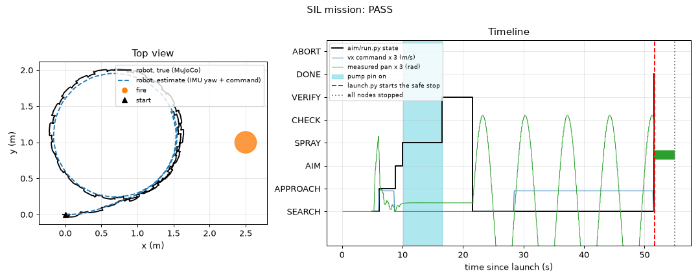

# Robot runtime

This folder holds the software of the robot computer, a Radxa ROCK 3C.
`launch.py` starts the camera, aiming, actuator and leg programs, watches them, and stops the robot safely.
Each program has a fake backend, so the whole robot also runs on a laptop.
All ports, devices, pins, ids and limits are in one file: `config.toml`. The ports and messages are in [docs/architecture.md](../docs/architecture.md).

- **Not verified:** Nothing in this folder has run on the ROCK 3C or on real hardware yet.
- **Assumed:** The pump runs while header pin 11 is high (`[pump] active_low = false`). The DMC-101 datasheet is not available yet.
- **Assumed:** GPIO bank 3 is `/dev/gpiochip3`. `gpiodetect` on the board confirms the number.
- **Open:** The Arducam documents do not give the camera USB id. We read it on the first day (bring-up step 3).

## Status

| Part | Status |
|---|---|
| `config.toml`, `robot_config.py`: one config file for all programs | built, tested in simulation |
| `launch.py`: start order, heartbeats, safe stop, logs | built, tested in simulation |
| `pump.py`: pump on/off line, spray time limit, keepalive watchdog, e-stop input | built, tested in simulation (mock pin) |
| `camera_node.py`: camera, folder or video frames, detector, frame messages | built. Synthetic, folder and video sources: tested in simulation. Real camera: planned |
| `fake_world.py`: fake fires and the synthetic camera of `--sim` | built, tested in simulation |
| `bench.py`: tests for the first hardware days | built, tested in simulation (`--mock`) |
| `setup/install.sh`: packages, udev rules, CAN at boot, IMU UART, services | built. We ran its dry run on a laptop. |
| `sil.py`: end-to-end test with one mission and two faults | built, tested in simulation |
| Policy loop in 4 SIL runs: 3.0 to 8.3 ms per tick on average, 33.5 ms at most (limit 40 ms) | measured on laptop |
| Everything on the ROCK 3C | planned |

`test_robot.py` holds the fast tests. `results/` holds the SIL table and plots. `logs/` holds one folder per run and is not in git.

## Three modes

| Program | `--sim` (laptop) | `--bench` (robot without legs) | `--full` (whole robot) |
|---|---|---|---|
| `actuators/actuator_node.py` | mock servos, mock pump pin (a file) | ST3215 servos, pump GPIO | as `--bench` |
| `robot/camera_node.py` | synthetic camera, colour-threshold detector | Arducam B0201, `vision/detector.py` | as `--bench` |
| `legs/run_policy.py --udp` | fake CAN bus with the MuJoCo biped | not started | 12 drives and the IMU |
| `aim/run.py F2 --feedback` | walks | `--no-walk`: stands still | walks |

- `--sim --bench` runs the fake world without legs.
- `--send ready` tells a running `launch.py` that the robot stands, so the policy starts. Enter in its terminal does the same.
- `--send stop` starts the safe stop from another terminal or over ssh.
- `--camera video:PATH` or `--camera folder:PATH` sends recorded images through the fire detector.
- Logs go to `robot/logs/<time>-<mode>/`: `launch.log` (events), `telemetry.jsonl` (all messages), one log per program.
- The exit code is 0 after a stop by the operator, 1 after a fault and 2 when a program did not start.
- `ROBOT_CONFIG=file` selects another config file. `ROBOT_PORT_OFFSET=n` moves all ports, for tests.

## Run it on a laptop

Run all commands from the repository root. Do steps 1 to 3 once.

1. Install the environment with `uv sync`.
2. Fetch the Berkeley Humanoid Lite (BHL) model files into `third_party/`:

```sh
bash scripts/fetch_bhl_assets.sh
```

3. Build the MuJoCo models. The fake legs use `sim/payload/models/bhl_biped.xml`.

```sh
uv run python sim/payload/models.py
```

4. Run the fast tests of `aim/`, `actuators/` and `robot/` (about 30 s):

```sh
uv run pytest -q
```

5. Run the leg tests on the fake CAN bus with `uv run pytest legs -q`.
6. Start the whole robot in simulation. Press Ctrl+C to stop it.

```sh
uv run python robot/launch.py --sim
```

7. Run the software-in-the-loop test (about 1.5 min):

```sh
uv run python robot/sil.py
```

Result on 2026-10-22: 66 tests pass in step 4, 6 tests in step 5, and 3 of 3 scenarios in step 7.

## Software-in-the-loop (SIL) results

`sil.py` runs the real `launch.py --sim` with the F2 config and injects faults.
The legs run on the fake CAN bus with the MuJoCo biped. The servos and the pump are mocks.
The detector is the colour-threshold baseline. The full table is in [results/sil_results.md](results/sil_results.md).

| Scenario | Result | What happened |
|---|---|---|
| mission | PASS | The robot turned 24 deg and came 0.93 m closer to the fire. The pump was on for 6.4 s and the fire went out. VERIFY, 30 s of search, DONE, clean stop. |
| hung_actuator | PASS | `sil.py` froze the actuator node 1 s after the pump switched on. The pump pin went low 0.61 s later. Exit code 1. |
| camera_dies | PASS | `sil.py` killed the camera node while the robot walked. `launch.py` stopped everything. The pump stayed off. Exit code 1. |



### SIL findings

- From a stand, the fake legs did not start to walk at 0.25 m/s. They moved 0.02 m in 9.5 s.
- So the walking bridge sends a start kick of 0.45 m/s for 0.5 s (`config.toml` `[walk]`). With the kick, the legs started in 7 of 7 runs.
- The fake legs use the bare BHL biped, the drive model of `legs/fake_bus.py` and the knee limit 1.4 rad. The real robot can differ.

## Bring-up on the robot

Do the steps in this order. Each `bench.py` test prints PASS, FAIL or WARN with a hint. `--mock` runs it without hardware.

### 1. SD card

- Write `rock-3c_bookworm_kde_b1.output_512.img.xz` ([Radxa releases](https://github.com/radxa-build/rock-3c/releases)) to a 32 GB microSD card with balenaEtcher.
- **CAUTION:** Writing the image erases the card. Check the drive letter first.
- **CAUTION:** The ROCK 3C takes 5 V only. 12 V on its USB-C port destroys the board.
- Boot it with Ethernet, HDMI and a keyboard. Log in as `radxa` with the password `radxa`, and change it with `passwd`.
- `hostname -I` gives the IP address. Then work over ssh.

### 2. Install

Clone the repository on the board, then go into it with `cd firefighter-robot`.

```sh
git clone https://github.com/promaaa/firefighter-robot.git
```

`bash robot/setup/install.sh --dry-run` shows each change and changes nothing.

**CAUTION:** The next command changes system files, user groups and the boot target. It prints each change, so you can undo it.

```sh
bash robot/setup/install.sh
```

- The script installs the system packages and uv, then runs `uv sync --extra board`.
- It writes the udev rules, the CAN service and the robot service (`robot@bench`, `robot@full`, not enabled).
- It sets the CPU governor to performance, enables the IMU UART overlay and boots to text mode.
- It changes only what is different, so you can run it again at any time. Reboot after it with `sudo reboot`.

### 3. Wiring and device names

Switch off the board. Wire the pump line, the e-stop sense line and the IMU ("Header pins" below).

**CAUTION:** A 5 V signal on a header pin can destroy the RK3566. Measure the IMU TX with a meter first: it must be below 3.4 V.

**CAUTION:** Do not plug a USB-C supply while the 5 V converter feeds header pins 2 and 4. The two supplies can damage each other.

Plug the two CANables, the servo adapter and the camera into the 4 USB ports. Switch on the board. Print the USB ids and serials:

```sh
bash robot/setup/install.sh --list-usb
```

- Unplug the right leg CANable and run it again. The serial that stays is the left leg adapter.
- Write both serials into `config.toml` `[can]`, and the camera id (vendor:product) into `[camera] usb`.
- Run `bash robot/setup/install.sh` again. Then plug each USB device out and in once.
- Run `gpiodetect`. When the chip with the label `gpio3` is not `gpiochip3`, correct `[pump] chip`.
- When the e-stop sense line is wired, set `[pump] estop_chip = "/dev/gpiochip3"`.

### 4. Preflight, every day before any test

Correct each FAIL with its hint and run the check again. A WARN line is information.

```sh
uv run python robot/bench.py preflight
```

### 5. Legs

Do [legs/README.md](../legs/README.md) parts A to D: CAN adapters, wiring, drive settings, first power-on and calibration.
Then check both CAN buses. The robot hangs from the gantry and the motor power is on. This test only reads, so no motor moves.

```sh
uv run python robot/bench.py can
```

All 12 drives must send heartbeats. Each bus must be ERROR-ACTIVE, and all encoder replies must arrive.

### 6. IMU

Set the IMU once to 200 Hz and 230400 baud with `uv run python legs/imu.py --setup` (legs/README.md part E).
Then check the rate and the axes. The test asks you to tilt the robot forward, then to its left.

```sh
uv run python robot/bench.py imu
```

When a sign is wrong, edit `IMU_TO_BODY` in `legs/imu.py`.

### 7. Pan-tilt calibration

Set the servo ids and the zeros ([actuators/README.md](../actuators/README.md), "Set the servo ids" and "Calibration").

**CAUTION:** The next command moves the nozzle to each limit at 30 deg/s. Keep your hands and the cables away.

```sh
uv run python robot/bench.py pantilt
```

When the nozzle or the hose touches something at a limit, make that limit smaller in `config.toml`. Each static error must be 2 deg or less.

### 8. Pump and jet test

This test measures the jet speed v0 for the aiming code.
Fill the tanks. Put the robot on a table with the nozzle over a clear floor and a tape measure along the jet.
Measure the height of the nozzle exit above the floor, and use it in place of 0.95. The pan-tilt holds the nozzle level.

**CAUTION:** The next command sprays water 3 times for 2 s. Keep the electronics dry. Point the nozzle away from people.

```sh
uv run python robot/bench.py pump --height 0.95 --seconds 2 --runs 3
```

- After each spray, type the distance from the point below the nozzle exit to the point where the jet hits the floor.
- Put the printed line `v0 = ...` into `config.toml` under `[aim.controller]`.
- Do the test again with `--tilt 20` to check the air drag ([aim/README.md](../aim/README.md), "Jet speed v0").
- The test adds its rows to `robot/bench_data/jet_test.csv`. Commit this file.

### 9. Camera

The test prints the formats and the controls, then measures the frame rate and the brightness for 5 s.

```sh
uv run python robot/bench.py camera
```

- Run it again with a lighter flame in view. The number of detections must grow.
- The snapshot in `robot/logs/bench/` shows the detection boxes.
- When the image is too dark or too bright, add `--exposure 150`. The list of controls shows the range.
- Calibrate the lens with `vision/calibrate.py` ([vision/README.md](../vision/README.md)).

### 10. Walking on the gantry

Do legs/README.md part F: the policy torque limit, then the policy with the robot on the gantry.

### 11. Full power-on and e-stop test

The robot hangs from the gantry with the feet off the floor and empty tanks.
Switch on PC POWER (S2: the computer and the servos) and wait 40 s for the boot. Then switch on MOTOR POWER (S3: the drives and the pump).
The switches are in [docs/hardware/electrical.md](../docs/hardware/electrical.md).
Run the preflight check (step 4): all lines must be PASS.

**CAUTION:** The next command moves the 12 joints to the default pose in 2 s, and the pan-tilt to its search pose.

```sh
uv run python robot/launch.py --full
```

- When `launch.py` asks for Enter, do not press it. Press the e-stop.
- The drives, the pump and the servos must lose power. `launch.py` must print "FAULT" and "all nodes stopped".
- Write the time from the e-stop press to "all nodes stopped" into the test log (`robot/logs/<time>-full/launch.log`).

### 12. First mission

Put a battery-powered orange lamp on the floor, 2.5 m in front of the robot and a little to the left. The jet hits it, so do not use a mains lamp.
For this first test, set `[camera] detector = "sim/sim2sim/baseline_detector.py"`. This colour threshold sees the lamp.
Hang the robot from the gantry with the legs straight down (legs/README.md, "Zeroing").

**CAUTION:** The next command moves the legs, then the robot walks and sprays. Keep the e-stop in your hand and 2 m free around the robot.

```sh
uv run python robot/launch.py --full
```

- When the robot stands on the floor with slack chains, press Enter.
- The robot searches, walks toward the lamp, aims and sprays. After 15 s of water, it ignores the lamp, because the lamp does not shrink.
- Then it searches for 30 s and stops at DONE. It stands still.
- Press Ctrl+C. The legs fold slowly (damping for 3 s), then the motors go off.
- Before a test with a real flame, set `detector = ""` again. The camera node then uses `vision/detector.py`.

Without a keyboard, `sudo systemctl start robot@bench` (or `robot@full`) runs `launch.py`. `journalctl -u robot@bench -f` shows its output.
With `robot@full`, run `.venv/bin/python robot/launch.py --send ready` when the robot stands.

**CAUTION:** `sudo systemctl enable robot@bench` starts the robot at each boot. Do it only after the bench tests pass.

## Header pins

The ROCK 3C header uses 3.3 V logic (3.63 V at most). The full pin plan is in `docs/hardware/electrical.md`.

| Pin | Signal | Use | Config |
|---|---|---|---|
| 2, 4 and 6, 14 | 5 V in and GND | board supply from the 5 V converter | |
| 11 | GPIO3_A1 (gpiochip3, line 1) | pump on/off: opto-isolator input, then the DMC-101. Pull-down 10 kΩ. | `[pump] chip`, `line` |
| 9 | GND | ground of the pump line | |
| 13 | GPIO3_A2 (gpiochip3, line 2) | e-stop sense: one NC contact to GND (pin 25), pull-up to 3.3 V (pin 1) | `[pump] estop_chip`, `estop_line` |
| 16, 18 | UART4_RX_M1, UART4_TX_M1 | IMU TX, IMU RX | `[imu] uart = "ttyS4"` |
| 17, 20 | 3.3 V, GND | IMU supply | |
| 8, 10 | UART2 debug console, 1 500 000 baud | keep free for a USB-serial cable | |

U-Boot and Linux write their boot messages to pins 8 and 10, so the IMU uses UART4.
To use pins 8 and 10 anyway, set `[imu] uart = "ttyS2"` and `overlay = "rk3568-uart2-m0"`. `install.sh` then removes the console.

## Device names

`install.sh` writes these names into `/etc/udev/rules.d/70-robot.rules`.

| Device | What | Config |
|---|---|---|
| `/dev/servo` | Waveshare Bus Servo Adapter (A), CH343 chip, USB `1a86:55d3` | `[actuator] servo_usb` |
| `/dev/imu` | IM10A on UART4 (`/dev/ttyS4`), overlay `rk3568-uart4-m1`, 230400 baud | `[imu]` |
| `/dev/video-fire` | Arducam B0201, capture node, MJPEG 640 × 480 at 15 fps | `[camera]` |
| `can_left`, `can_right` | CANable 2.0 Pro, candleLight firmware, USB `1d50:606f`, 500 kbit/s, txqueuelen 100 | `[can]` |
| `/dev/gpiochip3` | pump line 1, e-stop line 2 | `[pump]` |

## Safety limits

| Fault | What stops it | Time |
|---|---|---|
| A program exits | `launch.py` does the safe stop | 0.05 s, then the stop sequence |
| A program hangs (no heartbeat) | `launch.py` kills it and does the safe stop. For the actuator node, it forces the pump pin low at once. | camera 1.5 s, aim 1.0 s, actuator 0.5 s, legs 0.5 s |
| The actuator loop stops updating the pump | a thread in `pump.py` switches the pump off | 0.3 s (`keepalive_s`) |
| The pump is on too long | `pump.py` switches it off until the next "off" command | 12 s (`max_spray_s`). One F2 spray is 11 s at most. |
| `aim/run.py` stops sending | the actuator node switches the water off and the servos hold. The walking bridge sends speed 0. | 0.5 s |
| `launch.py` dies | each program gets SIGTERM (Linux parent-death signal) and stops | at once |
| Drive error, lost drive, joint beyond its limits, torso tilt above 0.78 rad | `run_policy.py`: damping for 3 s, then motors off. `launch.py` stops the rest. | one policy tick (40 ms) |
| CAN frames stop | the drive watchdog stops each motor | 1 s |
| E-stop | cuts the power of the drives and the pump (relay K1) and of the servos (relay K2). When wired, the sense line on pin 13 also blocks the pump. The drives and the servos then stop replying, so `launch.py` does the safe stop. | at once |

The safe stop of `launch.py` does these steps in this order:

1. Kill a hung program. For the actuator node, force the pump pin low.
2. Stop `aim/run.py`. Send "pump off, hold the angles, speed 0" to the actuator node and the legs.
3. Legs: damping for 3 s, then motors off.
4. Stop the camera node, then the actuator node. The pump goes off. The servos keep their torque and hold.
5. Force the pump pin low.

The knee target limit is 1.4 rad (`[legs] knee_max`), because at full knee range the foot touches a tank.
The aiming code has its own spray interlocks (aim/README.md, "Controller").

## Troubleshooting

| What you see | Likely cause | What to do |
|---|---|---|
| "camera exited" at the start | the detector model is missing, or `/dev/video-fire` does not exist | read `robot/logs/<time>/camera.log`. Check `[camera] detector` and bring-up step 3. |
| "no heartbeat ... hung" | a program blocks: serial port, CPU load | read the log of that program in `robot/logs/<time>/` |
| "Address already in use" | another `launch.py` or a test runs | `ss -ulpn` shows the program. Stop it, or set `ROBOT_PORT_OFFSET=10000`. |
| "CAN interface can_left does not exist" | no serials in `config.toml`, or no driver | `bash robot/setup/install.sh --list-usb`, then `sudo modprobe gs_usb` |
| CAN state ERROR-PASSIVE or BUS-OFF | termination, wiring, or no motor power | legs/README.md, "Termination resistors" |
| "IMU on /dev/imu: 0 frames" | TX and RX swapped, overlay off, wrong baud | swap the two wires. Run `legs/imu.py --setup`: a new IMU sends at 9600 baud. |
| the pump does not switch on | wrong gpiochip, or the other polarity | `gpioinfo` shows the lines. Correct `[pump] chip`, or set `active_low = true`. |
| the pump runs while the board boots | the pin floats high at boot | check the 10 kΩ pull-down from pin 11 to GND |
| "Permission denied" on `/dev/gpiochip3` or a tty | your user is not in the group yet | log out and in again after `install.sh` |
| ticks longer than 40 ms in `legs.log` | CPU too slow or busy | `install.sh` steps 7 and 10 (governor, no desktop). Add a heatsink. |

## ROCK 3C facts

We read these sources on 2026-10-15. "Guess" marks a value that we did not find in a source.

| Fact | Value | Source |
|---|---|---|
| Image | `rock-3c_bookworm_kde_b1`: Debian 12, KDE, kernel 6.1.84. Login radxa / radxa. | [releases](https://github.com/radxa-build/rock-3c/releases), [install](https://docs.radxa.com/en/rock3/rock3c/getting-started/install-os) |
| Power, logic | USB-C, 5 V only, 5 V 3 A without an SSD. Header logic 3.3 V, 3.63 V at most. | [hardware interface](https://docs.radxa.com/en/rock3/rock3c/hardware-design/hardware-interface) |
| UARTs | UART4_M1 on pins 16 (RX) and 18 (TX). UARTn is `/dev/ttySn`. Pins 8 and 10: debug console. | [overlays](https://github.com/radxa/overlays/tree/main/arch/arm64/boot/dts/rockchip/overlays), [serial](https://docs.radxa.com/en/rock3/rock3c/low-level-dev/serial) |
| GPIO | free: GPIO3_A1 (pin 11), GPIO3_A2 (13), GPIO3_B0 (15), GPIO3_A7 (36). Bank n is `/dev/gpiochipN` (guess). | [hardware interface](https://docs.radxa.com/en/rock3/rock3c/hardware-design/hardware-interface) |
| Overlays | `rsetup enable_overlays X.dtbo`, then a reboot | [rsetup](https://docs.radxa.com/en/rock3/rock3c/system-config/rsetup) |
| CAN | the 6.1 kernel has `CONFIG_CAN_GS_USB=m`. The candleLight USB id is `1d50:606f`. | Radxa kernel package, [candleLight](https://github.com/candle-usb/candleLight_fw/blob/master/include/config.h) |
| Servo adapter | CH343, `1a86:55d3`, `cdc_acm` driver: `/dev/ttyACM*` | [Waveshare FAQ](https://docs.waveshare.com/Bus_Servo_Adapter_A/FAQ) |
| Arducam B0201 | MJPEG at 30 fps up to 1080p. YUYV at 30 fps only up to 640 × 480. | Arducam product page |

## Open points

- No test on the ROCK 3C, the drives, the servos, the pump, the IMU or the camera.
- The real camera path (ffmpeg, V4L2, MJPEG) has not run. The video replay uses the same code with a file.
- The pose estimate has no leg odometry. It drifts when the robot slips or walks slower than commanded.
- `[camera] latency_s` is 0. We must measure the image delay on the board.
- The pump polarity and the DMC-101 control input are not known until the datasheet or the pump arrives.

Licence: code MIT (root `LICENSE`), this document CC BY-SA 4.0.
