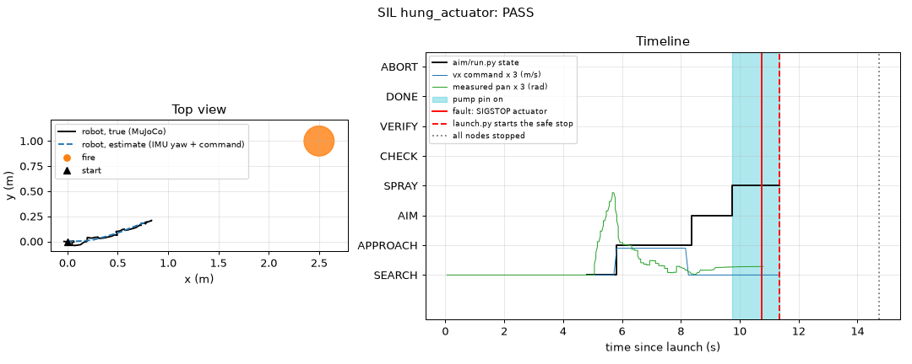
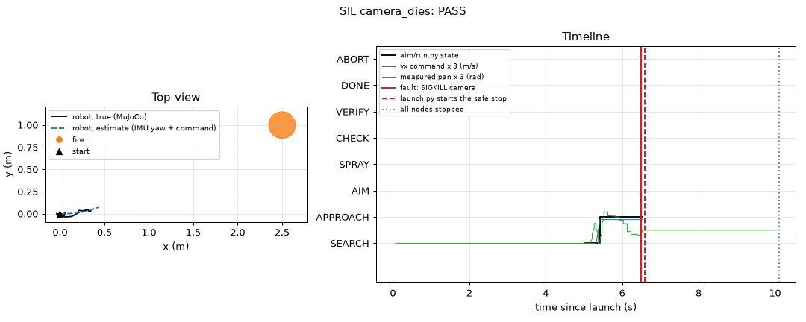

# SIL results (2026-10-22 18:31)

Written by `uv run python robot/sil.py`. Status: tested in simulation.

| Scenario | Result | States | Distance to the fire: start, at spray (m) | Largest turn (deg) | Pump on (s) | Fire health at the end | Stop reason | Exit code |
|---|---|---|---|---|---|---|---|---|
| mission | PASS | SEARCH APPROACH AIM SPRAY VERIFY DONE | 2.72, 1.79 | 24.4 | 6.39 | [0.0] | mission done (--stop-when-done) | 0 |
| hung_actuator | PASS | SEARCH APPROACH AIM SPRAY | 2.72, 1.85 | 24.2 | 1.62 | [0.451] | actuator: no heartbeat for 0.51 s (limit 0.5 s): hung | 1 |
| camera_dies | PASS | SEARCH APPROACH | 2.73, 2.36 | 18.8 | - | [1.0] | camera exited with code -9 | 1 |

## mission

- PASS: the robot walked toward the fire (0.4 m or more closer)
- PASS: the robot turned toward the fire (5 deg or more)
- PASS: the pump switched on
- PASS: the fire went out
- PASS: aim/run.py reached DONE
- PASS: launch.py exit code 0
- PASS: the legs got damping, then motors off
- PASS: all nodes stopped
- PASS: the pump pin is low at the end

## hung_actuator

Fault: SIGSTOP to the actuator node at 10.74 s. launch.py started the safe stop at 11.35 s. All nodes stopped at 14.73 s.
The pump pin went low 0.61 s after the freeze.

- PASS: launch.py saw the fault (actuator)
- PASS: launch.py exit code 1 (fault)
- PASS: the pump pin went low within 1.0 s of the freeze
- PASS: the legs got damping, then motors off
- PASS: all nodes stopped
- PASS: the pump pin is low at the end

## camera_dies

Fault: SIGKILL to the camera node at 6.49 s. launch.py started the safe stop at 6.59 s. All nodes stopped at 10.1 s.

- PASS: launch.py saw the fault (camera)
- PASS: launch.py exit code 1 (fault)
- PASS: the pump stayed off
- PASS: the legs got damping, then motors off
- PASS: all nodes stopped
- PASS: the pump pin is low at the end
