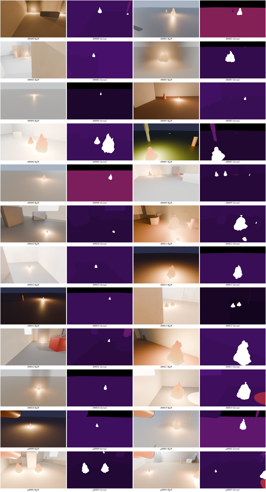

# Synthetic fire scenes for the fire detector

`firescenes.py` renders synthetic fire scenes in Blender. Each sample has an RGB image, a thermal-like image and labels.
The fire detector training set in `vision/` uses the RGB images and their boxes.

**Status:** built: the generator, the label check, 250 samples, 20 samples with a top module in view, a 10 s sequence and a contact sheet.
The label check is tested in simulation. Nothing is measured on laptop or on board.

**Assumed:** The camera pose is the RGB camera of `CONCEPTS["A"]` in `aim/geometry.py`, an older pan-tilt design.
It has a 90° horizontal field of view. The pan-tilt stays at its default tilt of 6° down. The F2 camera (Arducam B0201) has another pose and field of view.

**Not verified:** Nobody has compared these images with real camera images. Read "Domain gap" before you use them.



Figure 1. Samples 0 to 19 and g00000 to g00003: the RGB image and the thermal preview side by side.

## Get the samples

The samples are not in git: they are about 50 MB in 5,900 files. Only `out/contact_sheet.jpg` is in git.
To get the rendered samples without Blender, run these commands from the repository root:

```bash
curl -L -o firescenes_v1.zip https://github.com/promaaa/firefighter-robot/releases/download/firescenes-v1/firescenes_v1.zip
```

```bash
unzip -o firescenes_v1.zip -d sim/firescenes
```

## How to run

Blender 5.2 and an NVIDIA GPU (Cycles OptiX) are necessary. Run the commands from the repository root.

1. Make samples 0 to 199:

   ```bash
   blender -b --factory-startup -P sim/firescenes/firescenes.py -- samples 0 200
   ```

2. Make the 10 s walking sequence and its MP4 files. The command does nothing when `out/sequence/` already has frames.

   ```bash
   blender -b --factory-startup -P sim/firescenes/firescenes.py -- sequence
   ```

3. Make the contact sheet:

   ```bash
   blender -b --factory-startup -P sim/firescenes/firescenes.py -- sheet
   ```

4. Check the labels against `aim/geometry.py`:

   ```bash
   uv run python sim/firescenes/validate.py
   ```

- Sample number i always gives the same scene, because i is the random seed.
- One sample takes 10 to 13 s on an RTX 3090. To run two batches at the same time, give them different number ranges.
- When one sample fails, the batch continues and the log shows `SAMPLE FAILED <number>`.
- `firescenes.py` uses the Blender helpers of `cad/bhl.py` and the camera model of `aim/geometry.py`.

## Output files

All files are in `out/`. Each sample has a six-digit number, for example `000042`.

| Path | Content |
|---|---|
| `rgb/<id>.jpg` | RGB image, 1280 × 720, 90° horizontal field of view |
| `thermal/<id>.png` | Thermal image, 16-bit, deci-kelvin (0.1 K steps), 1280 × 720, same camera as the RGB image |
| `thermal_256/<id>.png`, `thermal_160/<id>.png` | Thermal images, 256 × 192 and 160 × 120, 56° horizontal field of view |
| `preview/<modality>/<id>.png` | 8-bit colour pictures of the thermal images, fixed range 15 to 80 °C |
| `labels/<id>.json` | Labels (see below) |
| `yolo/<modality>/` | YOLO folders (`images`, `labels`, `data.yaml`). Class 0 is "fire" |
| `contact_sheet.jpg` | Figure 1 |
| `sequence/` | 100 frames of a walk toward a fire, with the same folders, plus MP4 files |

- The YOLO image files are links to the RGB images and to the 8-bit thermal previews.
- To read a thermal PNG in °C, use for example `cv2.imread(path, cv2.IMREAD_UNCHANGED) / 10 - 273.15`.
- Samples g00000 to g00019 show an older water-gun top module in the top-left corner. Their labels have `gun_in_view` = true.

## Labels

Each `labels/<id>.json` file has:

- `scene` (indoor or outdoor), `lighting`, `ambient_c`, `distractors` and `gun_in_view`.
- `robot_pose_world`: the robot x, y (m) and heading (rad) in the scene.
- `camera`: pan and tilt (rad) as `aim/geometry.py` uses them, and the camera pose in the robot frame.
- `images`: for each image, the file, the size and the pinhole intrinsics (`fx`, `fy`, `cx`, `cy`).
- `fires`: for each fire, the base and centre in the robot frame, the distances, the size, the temperatures and `smoke`.
- `boxes`: the box of each fire in each image, (u_min, v_min, u_max, v_max) in pixels, or `null` when less than 4 pixels are visible.

The boxes come from the renderer. A fire behind furniture has a smaller box or no box.

## What the scenes contain

- Scene: an indoor room (65 %, 6 to 12 m by 5 to 9 m, 2 to 6 furniture boxes) or outdoor ground (35 %).
- Lighting: ceiling lamps, a window with sun or dim light indoors. Sun, overcast or dusk outdoors.
- Fires: 1 to 3 flame-shaped meshes, 10 to 60 cm wide, with an orange light. 30 % have smoke in the RGB image.
- Distractors: a person, a floor lamp with a hot shade, red or orange boxes, cylinders and cones, and sun spots on the floor.
- Robot: 0.8 to 6 m from fire 1, facing it within 29°. The camera pan and tilt shake by up to 1.5°.

## Thermal model

- Each object has one temperature. Flames: 600 to 900 °C, hottest at the base. Person: 34 °C. Lamp shade: 80 to 200 °C.
- Walls are at the ambient temperature (20 to 30 °C). Sun spots are 8 to 20 °C above it.
- The low-resolution images average blocks of a 1280 × 960 render. So a small fire raises a pixel only partly.
- It is not a sensor model. There is no noise, no blur, no automatic gain, no emissivity, no reflection and no heat spread.

## Label check

`validate.py` reads every label file. It rebuilds the camera pose with `aim/geometry.py` and checks that it is the renderer pose.
It projects each fire centre into each image and measures the distance to the centre of the fire's box.
It also checks that no thermal pixel clips and that the hottest pixel in each fire box has a flame temperature.

Result for samples 0 to 249 and g00000 to g00019 (tested in simulation):

| Image | Fires | Centre inside the box | Mean error (px) | Median (px) | Max (px) |
|---|---|---|---|---|---|
| rgb | 339 | 98 % | 8.3 | 5.5 | 92.8 |
| thermal_256 | 237 | 98 % | 2.6 | 1.8 | 32.0 |
| thermal_160 | 234 | 98 % | 1.7 | 1.1 | 19.9 |

- No thermal pixel clips. The hottest pixel in the fire box has a flame temperature for 99 % of 357 fires.
- The script skips boxes that touch the image edge, because the edge cuts the fire and moves the box centre.

## Domain gap

- The flames are smooth glowing shapes. Real flames are partly transparent, change shape fast and have sparks and soot.
- The rooms are simple boxes with plain colours. Real rooms have texture, clutter, glass and screens.
- The RGB images have no motion blur, no camera noise and no auto exposure.
- Use these images to test the pipeline, the label format and the geometry. Test the detector on real fire images before you trust it.

## Licence

Code: MIT (root `LICENSE`). This README and the rendered images (the contact sheet and the release archive): CC BY-SA 4.0.
