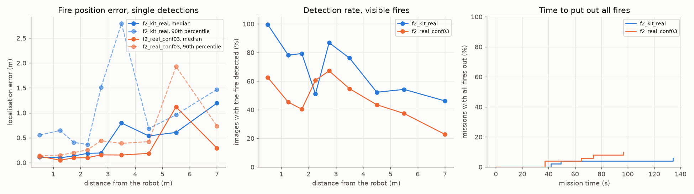
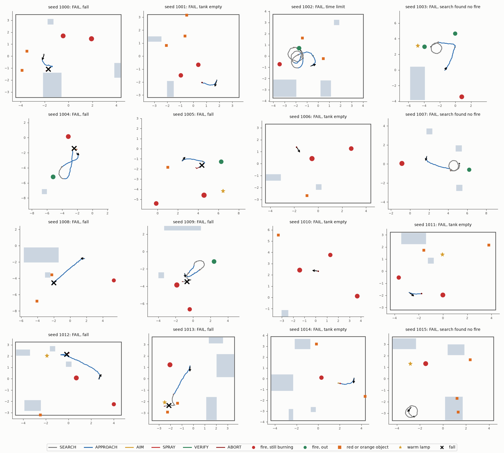
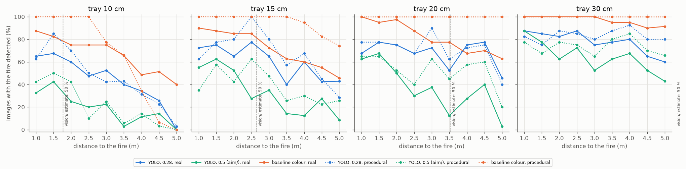

# Mission simulation: the final robot F2 puts out fires

This folder simulates complete missions of the final design F2 in MuJoCo.
The robot walks with an ONNX policy, sees the room with its camera, finds the fires with a detector, aims the pan-tilt and sprays water.
The same random missions run for each configuration, so we can compare detectors, policies and settings.

**Status:** tested in simulation. The software-in-the-loop mode (the real robot programs over UDP) is tested in simulation on the laptop.

- **Assumed:** the jet in the mission model is 0.39 L/min and 9.2 m/s at 11.1 V. This is the gear-pump comparison of `sim/water`, which the campaign runs use.
- **Open:** the KLP02 estimate is 0.42 L/min and 10.0 m/s at 22.2 V ([docs/hardware/water.md](../../docs/hardware/water.md)). The campaign must run again with these values.
- **Assumed:** the fire model and all model errors below are estimates. No fire test has checked them.

## What the simulation contains

| Part | What it does |
|---|---|
| Robot | `sim/payload/models/bhl_F2.xml` (15.99 kg, tanks full). The ST3215 pan-tilt is two joints with position servos: 4.7 rad/s, 2.9 Nm, pan ±90°, tilt −40° to +45°. |
| Walking | Any ONNX policy with the BHL interface (45 inputs, 12 outputs, 25 Hz). Default: the shipped BHL policy. |
| Leg drives | Case 7 of `sim/sim2sim/hw_risks.py`: PD in the drive (K 20, D 2), 6 Nm limit, joint zero error ±2°, 10 ms command latency. Physics at 2 kHz. |
| Camera | Arducam B0201 on the tilt head: 640 × 480, 97.1° horizontal, pinhole model, 10 Hz. Mounting error ±1°, exposure ±15 %, pixel noise. |
| Fire images | Animated flame sprites, drawn as billboards with a depth test against the MuJoCo depth buffer, plus a glow. `--flames real` uses clips of real fires (`sprites/`). |
| Detector | Any module with `detect(rgb, t)`. Default: `sim/sim2sim/baseline_detector.py` (colour threshold). `oracle` gives the true flame boxes. 100 ms delay. |
| Mission logic | `aim/controller.py` with the F2 values of `aim/geometry.py` |
| Water | Droplets with gravity and air drag, 400 per second. Walls and furniture stop them. |
| Odometry | Distance scale error ±10 %, gyro bias ±0.05 °/s. Roll and pitch are exact. |
| Scenes | A random room (7 to 10 m × 6 to 8 m, a door, 2 to 4 pieces of furniture) or an outdoor area (25 % of missions). 1 to 3 round tray fires of 10 to 20 cm, 1.5 to 5 m from the start. 1 to 3 red or orange objects. A warm lamp in 70 % of missions. |

## Mission logic

1. **SEARCH:** the robot stands and scans with the pan. Then it walks a small circle and keeps scanning. After 30 s with no fire, it goes to DONE.
2. **APPROACH:** 3 detections within 0.6 s confirm a fire. The robot walks toward it at 0.3 m/s and stops at 2 m.
3. **AIM:** the pan-tilt turns to the ballistic solution. The pump stays off until both axes are within 2°.
4. **SPRAY:** the aim point sweeps ±8 cm along the line of sight. The pump stays on for 4 s after the last detection. One spray lasts at most 11 s.
5. **No response to water:** after 15 s of pump time, the flame box must shrink below 90 %. If not, the robot ignores this target and searches again.
6. **VERIFY:** the pan-tilt holds for 5 s. If the fire shows again, the robot aims again.
7. **DONE:** after a search with no fire, when the tank is empty (115 s of pump time), or at the 240 s time limit.
8. **ABORT:** a torso tilt above 0.6 rad stops the pump and the walk. The leg drives then only damp (K = 0, D = 2).

## Fire and water model

| Item | Value (design `f2` in `world.py`) |
|---|---|
| Jet | 0.39 L/min and v0 = 9.2 × (V / 11.1)^0.73 m/s, V = 10.5 to 12.6 V per mission. `aim/` gets the same v0. The true jet is within ±3 %. |
| Drag | 0.11 1/m in `aim/`. The true jet has ±20 %. |
| Usable water | 0.749 L of 0.781 L |
| Jet recoil on the tilt head | 0.3 to 1.3 N. This is a worst case: the jet gives only 0.06 N. |
| Water to put out a full fire | 2.5 L per m² of tray |
| Regrowth from 0 to full strength | 13 s, while the strength is above 0 |
| Hit | a droplet inside the tray cylinder, below half the flame height |
| Flame height | 2.5 × tray diameter × strength^0.4 |

The lowest water rate that beats the regrowth is 11.5 L/(m² min). Water applied by hand needs 9 to 15 L/(m² min) (`docs/hardware/water.md`, section 7).
With 70 % of the water on the tray, a tray above about 17 cm does not go out.

## How to run

Run all commands from the repository root. First build the robot models once: `uv run python sim/payload/models.py`.

1. Run the self-checks (about 10 s):
   ```
   MUJOCO_GL=egl uv run pytest sim/mission/test_mission.py -q
   ```
2. Run one mission and print the result. A seed always gives the same room, fires and model errors.
   ```
   MUJOCO_GL=egl uv run python sim/mission/mission.py --seed 1055
   ```
3. Add a video: `--video mission_1055.mp4`. Other options: `--detector FILE` (or `oracle`), `--policy FILE`, `--limit 9`, `--flames real`, `--min-conf 0.3`, `--indoor`, `--outdoor`, `--json FILE`.
4. Run the same mission with `aim/run.py` and `actuators/actuator_node.py --mock` as separate processes over UDP. It runs in real time.
   ```
   MUJOCO_GL=egl uv run python sim/mission/mission.py --seed 1055 --sil
   ```
5. Run 50 missions of one configuration of `campaign.py` (3 processes). Each mission writes `~/runs/firefighter/mission/campaign/<configuration>/<seed>.json`, so a stopped run continues.
   ```
   MUJOCO_GL=egl uv run python sim/mission/campaign.py run f2_real_conf03 50
   ```
6. Make the tables and figures from all finished missions (`results/campaign.md`, `results/campaign.json`, `results/fig_*.png`):
   ```
   uv run python sim/mission/campaign.py report
   ```
7. Rebuild the real-fire sprites in `sprites/`. The script downloads the videos once (`sprites/SOURCES.md`).
   ```
   uv run python sim/mission/make_sprites.py
   ```
8. Check the detection rate against distance (about 5 min, `results/sprite_check.md`):
   ```
   MUJOCO_GL=egl uv run python sim/mission/sprite_check.py
   ```

## Results

Status: tested in simulation. 50 missions per configuration, real-fire flames, shipped BHL policy, 6 Nm. Full tables: [results/campaign.md](results/campaign.md).

| Configuration | Detector | Success | Fires out | Falls | Missions with a false spray | Water on a fire |
|---|---|---|---|---|---|---|
| `f2_kit_real` | colour baseline | 3 of 50 | 27 of 102 | 19 | 16 | 54 % |
| `f2_real_conf03` | YOLO11n (`vision/detector.py`), `min_conf` 0.3 | 5 of 50 | 25 of 102 | 13 | 0 | 78 % |

Success means every fire out, with no fall or ABORT.

1. Falls and an empty tank end most missions. Falls end 13 to 19 missions of 50, an empty tank 16 to 17.
2. No tray of 17.5 cm or more goes out (0 of 20 in both configurations). The jet and the fire model limit the tray size.
3. The YOLO detector gives no false spray in 50 missions, and 78 % of its water hits a fire. The colour baseline sprays at red objects and lamps.
4. The YOLO detector finds a visible fire in 40 to 67 % of the images at 1 to 4 m. The median largest detection distance is 3.1 m.



Figure 1. Fire position error and detection rate against distance, and the share of missions with all fires out against time.



Figure 2. The first 16 missions of `f2_kit_real`: room, furniture, fires (green: out), red or orange objects, lamp, and the path coloured by state. An X marks a fall.

### Detection rate check

`sprite_check.py` renders 2840 robot camera images of one fire at 1 to 5 m. Full tables: [results/sprite_check.md](results/sprite_check.md).

- With real-fire flames, YOLO11n at its own threshold (0.28) finds 54 to 69 % of the flames that are 12 to 32 px wide.
- At a threshold of 0.5, it finds far fewer. The F2 controller uses `min_conf` 0.3 (`aim/geometry.py`).
- YOLO11n gives no false detection in these images. The colour baseline gives 0.33 per image.



Figure 3. Share of images with the fire detected, per tray size and distance. Solid: real-fire flames. Dotted: procedural flames.

## Files

| File | What it does |
|---|---|
| `world.py` | Random mission spec, scene XML, textures, flame sprites with the depth test, droplets, fire model |
| `mission.py` | One mission: policy, leg drives, servos, camera, detector, `aim/` controller, water, fire. Video and SIL mode |
| `campaign.py` | Monte Carlo runs in parallel (`run`) and the tables and figures (`report`) |
| `test_mission.py` | Self-checks: camera and nozzle against `aim/geometry.py`, leg drive, droplets, fire model, sprites |
| `make_sprites.py`, `sprites/` | Real-fire flame clips from public videos. Sources and licences: [sprites/SOURCES.md](sprites/SOURCES.md) |
| `sprite_check.py` | Detection rate against distance on rendered robot camera images |
| `results/` | Campaign tables (`campaign.md`, `campaign.json`), figures and the sprite check |

## Open points and limits

- **Open:** run the campaign again with the KLP02 jet. Falls are the largest problem: test 9 Nm after the gearbox check, or a policy that starts and stops safely.
- **Open:** use test trays of 15 cm or less with this jet. Or raise the share of water on the tray (now 54 to 78 %).
- **Not verified:** the flame sprites are flat and have no smoke. The camera has no lens distortion, motion blur or auto exposure.
- **Not verified:** the fire model comes from literature values, not from a fire test. Water on the floor does not make it slippery.
- The robot has no obstacle avoidance. The detector runs at a fixed 10 Hz. 50 missions give a 95 % interval of about ±14 points on a success rate.

## Licence

Code: MIT (root `LICENSE`). This README and the result files: CC BY-SA 4.0.
Each sprite keeps the licence of its video (public domain, CC BY 2.0 or CC BY-SA 4.0). Give the attributions of `sprites/SOURCES.md` when you share a sprite or an image made with it.
