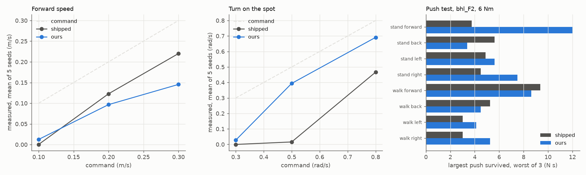

# Walking policy: training and evaluation

This folder trains walking policies for the Berkeley Humanoid Lite (BHL) legs of our robot.
Training uses reinforcement learning with Brax PPO on MuJoCo MJX (JAX, GPU).
PPO (Proximal Policy Optimization) is the usual learning method for legged robots.
The evaluation compares a policy with the shipped BHL policy in CPU MuJoCo, on the final design F2.

**Status:** built and tested in simulation. Nothing here is measured on laptop or measured on board.

## Policies

| File | What it is |
|---|---|
| `sim/sim2sim/policy_biped_25hz_a.onnx` | The shipped BHL policy (MIT licence) |
| `policies/f1_v1.onnx` | Our policy, fine-tuned from the shipped weights |
| `policies/f1_v1.json` | Card of f1_v1: interface, training stages and settings |

Both files have the same interface: 45 inputs, 12 outputs, joint target = default + 0.25 × action, 25 Hz.
So f1_v1 is a drop-in file for `legs/run_policy.py` and `sim/sim2sim/run.py`.
f1_v1 was trained on the earlier F1 model (15.24 kg). We evaluate it on F2 (15.99 kg with full tanks).

## Setup (once)

1. Fetch the BHL meshes and URDF (from the repository root):
   ```
   scripts/fetch_bhl_assets.sh
   ```
2. Build the MuJoCo models of the robot. This writes `sim/payload/models/bhl_F2*.xml`:
   ```
   uv run python sim/payload/models.py
   ```
3. Install the training environment. It needs Linux and an NVIDIA GPU:
   ```
   cd sim/rl && uv sync
   ```
4. Run the CPU self-check of the training task (about 1 min):
   ```
   cd sim/rl && JAX_PLATFORMS=cpu uv run python f1_env.py
   ```
   It prints `check passed: model mass 15.99 kg, observation matches run.py`.

`sim/rl/pyproject.toml` keeps JAX below 0.9, because newer JAX removes functions that Brax 0.14 needs.
The evaluation runs in the root environment, on the CPU. It does not need JAX.

## Train

The training task is `f1_env.py`. It copies the BHL Isaac Lab task: the 45 inputs, the rewards and the 0.78 rad fall limit.
It adds our robot and hardware:

- the model `bhl_F2.xml`, with the water from empty to full
- payload masses × 0.8 to 1.2, and the payload centre of mass ± 3 cm
- knee range 0 to 1.4 rad (the foot touches a tank at full knee range)
- torque limit 6 to 9 Nm, command and observation latency 0 to 20 ms, joint zero error ± 0.05 rad
- a recoil force of up to 1.5 N at the nozzle, and a constant force and torque on the torso
- a command mix of stand, turn on the spot and slow walking, with a new command every 3 to 8 s

Run the two stages of f1_v1 from `sim/rl/`. `XLA_PYTHON_CLIENT_MEM_FRACTION` limits the GPU memory of JAX, so other jobs can share the GPU.

1. Stage 1: start from the shipped weights, 9 Nm, mild randomisation, no pushes (121 M steps, 36 min on a shared RTX 3090):
   ```
   XLA_PYTHON_CLIENT_MEM_FRACTION=0.45 uv run python train_f1.py runs/f1_d 120e6 --evals=12 --warm=../sim2sim/policy_biped_25hz_a.onnx --std=0.2 --lr=1e-4 --kl=0.005 --entropy=0.002 "--set=torque_range=[9.0,9.0]" "--set=act_delay_steps=2" "--set=obs_delay_steps=2" "--set=push.enable=False" "--set=reset_wrench=[0.5,0.5]" "--set=zero_offset=0.03" "--set=cmd_mix=[0.15,0.3,0.35,0.2]" "--set=reward.no_step=-2.0"
   ```
2. Stage 2: 6 to 9 Nm, full latency and zero error, no pushes (101 M steps, 34 min):
   ```
   XLA_PYTHON_CLIENT_MEM_FRACTION=0.45 uv run python train_f1.py runs/f1_e 100e6 --evals=10 --restore=runs/f1_d/params_latest.pkl --lr=1e-4 --kl=0.005 --entropy=0.002 "--set=cmd_mix=[0.15,0.25,0.4,0.2]" "--set=push.enable=False" "--set=reward.no_step=-2.0" "--set=reward.stand_feet_air=-1.0" "--set=tracking_std=0.15"
   ```
3. Export the ONNX file to `runs/f1_e/policy.onnx`. The script checks the ONNX output against the JAX policy:
   ```
   JAX_PLATFORMS=cpu uv run python export_onnx.py runs/f1_e
   ```

Each run writes `config.json`, `progress.jsonl` and `params_<step>.pkl` into its folder. The `runs/` folder stays local (git-ignored).
`--set=<key>=<value>` changes one setting of `default_config()` in `f1_env.py`.

To run an ONNX policy inside the training simulator, with one randomisation term at a time (GPU):
```
cd sim/rl && XLA_PYTHON_CLIENT_MEM_FRACTION=0.3 uv run python mjx_check.py ../sim2sim/policy_biped_25hz_a.onnx 6 --terms
```

## Evaluate

Run these commands from the repository root:

| What | Command | Time | Output |
|---|---|---|---|
| Help | `uv run python sim/rl/f1_eval.py --help` | 1 s | - |
| Short check of one policy, 2 seeds | `uv run python sim/rl/f1_eval.py sim/rl/policies/f1_v1.onnx --quick` | 15 s | screen only |
| Full comparison with the shipped policy, 6 Nm | `uv run python sim/rl/f1_eval.py sim/rl/policies/f1_v1.onnx` | 10 to 18 min | `results/f2_eval_f1_v1.*` |
| The same at 9 Nm | `uv run python sim/rl/f1_eval.py sim/rl/policies/f1_v1.onnx --limit=9` | 10 to 18 min | `results/f2_eval_f1_v1_9nm.*` |
| Three videos | `MUJOCO_GL=egl uv run python sim/rl/f1_eval.py sim/rl/policies/f1_v1.onnx --video` | - | `results/*.mp4` (local) |

The loop is the one of `sim/sim2sim/run.py`: 25 Hz policy, 2 kHz physics, PD 20 / 2, training noise, BHL start drop.
It adds the joint target clip of `legs/robot.py` (knee ≤ 1.4 rad), a moving pan-tilt and a recoil force at the nozzle.
The push test uses `sim/payload/torso_tank.py`. The drive cases use `sim/sim2sim/hw_risks.py` (cases 1, 7 and 7b).

## Results on F2

Status: tested in simulation. Model `bhl_F2.xml`, 15.99 kg (15.21 kg with empty tanks).
Full tables: [results/f2_eval_f1_v1.md](results/f2_eval_f1_v1.md) (6 Nm) and [results/f2_eval_f1_v1_9nm.md](results/f2_eval_f1_v1_9nm.md) (9 Nm).
The push test and the drive cases keep their own limits, so they are only in the 6 Nm columns.

| Result | Shipped, 6 Nm | Shipped, 9 Nm | f1_v1, 6 Nm | f1_v1, 9 Nm |
|---|---|---|---|---|
| Falls, 65 command runs | 6 | 0 | 0 | 0 |
| Falls, 64 start-from-a-stand runs | 23 | 0 | 0 | 0 |
| Falls, 120 drive-model runs | 9 | - | 0 | - |
| Speed at a 0.3 m/s command (m/s) | 0.22 | 0.28 | 0.15 | 0.19 |
| Yaw rate, turn on the spot at 0.5 rad/s (rad/s) | 0.02 | 0.01 | 0.39 | 0.41 |
| Smallest push survived while standing (N s) | 3.8 (forward) | - | 3.4 (back) | - |
| Highest knee angle at a 0.3 m/s command (rad) | 1.56 | 1.36 | 1.17 | 1.12 |



1. f1_v1 does not fall in the command, start and drive tests. The shipped policy falls in 6 of 65 command runs at 6 Nm.
2. f1_v1 turns on the spot at a 0.5 rad/s command (0.39 rad/s). The shipped policy does not (0.02 rad/s).
3. f1_v1 walks more slowly: 0.15 m/s at a 0.3 m/s command, against 0.22 m/s.
4. At 9 Nm, neither policy falls. The shipped policy then walks at 0.28 m/s.
5. f1_v1 is weaker against a backward push while standing (3.4 against 5.6 N s). It is stronger against a forward push (12.0 against 3.8 N s).
6. f1_v1 keeps the knee below 1.4 rad. The runtime clips the knee target of the shipped policy.
7. At 0.10 m/s, neither policy walks. Command at least 0.2 m/s.

## Files

| File | What it does |
|---|---|
| `f1_env.py` | Training task for MJX. Run it for the CPU self-check. |
| `train_f1.py` | PPO training. `--warm=<onnx>` starts from ONNX weights, `--restore=<pkl>` from a checkpoint. |
| `export_onnx.py` | Writes `policy.onnx` of a run, in the form of the BHL file, and checks it. |
| `f1_eval.py` | CPU comparison with the shipped policy: commands, start from a stand, pushes, drive cases, videos. |
| `mjx_check.py` | Runs an ONNX policy inside the MJX training simulator. |
| `policies/` | f1_v1 and its card |
| `results/` | F2 evaluation tables and the figure |
| `pyproject.toml`, `uv.lock` | The training environment (JAX, Brax, MuJoCo MJX, MuJoCo Playground) |

## Open points

- **Not verified:** f1_v1 has not run on a laptop or on the robot. Test it on the gantry first, at 6 Nm with `--knee-max 1.4`.
- **Open:** f1_v1 was trained on F1, not on F2. A new training run uses `bhl_F2.xml` by default.
- **Open:** f1_v1 walks at only 0.15 to 0.19 m/s at a 0.3 m/s command.
- **Open:** f1_v1 is weak against a backward push while standing.
- **Open:** neither policy turns on the spot at 0.3 rad/s.
- **Open:** on the fake drives of `legs/` (bare biped), neither policy started to walk from a stand at 0.25 m/s. We do not know the cause yet.
- **Not verified:** the MJX and CPU models have no motor dynamics, no CAN jitter and a flat floor only.

## Licence

Code: MIT (root `LICENSE` file). `policies/f1_v1.onnx` is fine-tuned from the BHL weights `policy_biped_25hz_a.onnx`,
which are MIT (`sim/sim2sim/BHL_LICENCE`). The training task follows the BHL Isaac Lab task config (MIT).
