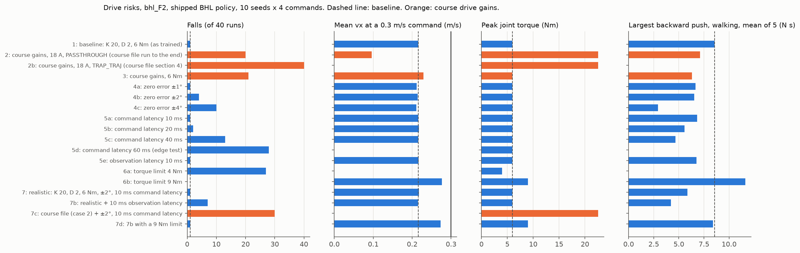

# Sim-to-sim: the shipped BHL walking policy and the motor drive risks

This folder holds the shared code that runs the shipped Berkeley Humanoid Lite (BHL) walking policy in MuJoCo.
It also holds `hw_risks.py`, a study of the course motor drives on the final design F2.

**Status:** tested in simulation (MuJoCo 3.15.0, Python 3.12, CPU only). Nothing here is measured on board.

## Setup

Run these commands once, from the repository root:

1. Install the Python environment: `uv sync`
2. Fetch the BHL meshes and URDF (not in git): `scripts/fetch_bhl_assets.sh`
3. Build the MuJoCo models `sim/payload/models/bhl_*.xml`: `uv run python sim/payload/models.py`

## Files

| File | What it is |
|---|---|
| `run.py` | Shared helpers: policy file, joint order, default pose, gains, observation, one simulation run, video, self-check |
| `hw_risks.py` | Sim-to-real risks of the course motor drives on the F2 model |
| `baseline_detector.py` | Colour-threshold fire "detector" for simulated cameras. Not a real detector |
| `policy_biped_25hz_a.onnx` | The shipped BHL walking policy |
| `BHL_LICENCE` | The MIT licence of the BHL code, which the policy copy requires |
| [`results/hw_risks.md`](results/hw_risks.md) | All tables, findings and the recommendation of `hw_risks.py` |
| `results/hw_risks.json`, `results/hw_risks.png` | Raw results and the summary figure |

## Shared helpers (`run.py`)

`legs/`, `robot/`, `sim/mission`, `sim/rl`, `sim/payload` and `docs/hardware/power_calc.py` import `run.py`.
It copies the rules of the BHL runtime. "BHL" is the main repository at commit `984741a`. "LL" is the low-level repository at commit `652777c`.

| Part | Value in `run.py` | BHL source |
|---|---|---|
| Policy | `policy_biped_25hz_a.onnx`, input `obs` (1 × 45), output `actions` (1 × 12) | BHL `checkpoints/`, LL `policy/rl_controller.py:49-67` |
| Observation | command (3), angular velocity (3), projected gravity (3), joint position − default (12), joint velocity (12), last action (12) | LL `policy/rl_controller.py:161-184` |
| Joint target | default + 0.25 × action. Default: hip pitch −0.2, knee 0.4, ankle pitch −0.3, others 0 rad | LL `policy/rl_controller.py:190-195` |
| PD control | torque = 20 × (target − position) − 2 × velocity, clipped to the torque limit | BHL `environments/mujoco.py:183-201` |
| Rates | policy 25 Hz, physics 2000 Hz | BHL `configs/policy_biped_25hz_a.yaml` |
| Start state | base at (0, 0, 0), upright, default joints. The robot then drops about 4 cm onto its feet | BHL `environments/mujoco.py:143-155` |
| Observation noise | uniform, as in the training (`NOISE`) | BHL `biped/env_cfg.py:55-72` |

- A fall is a torso tilt above 0.78 rad (the BHL training limit) or an IMU height below 60 % of its start height.
- `simulate()` returns the fall time, the mean forward speed and yaw rate from 5 s to 20 s, and torque numbers.

Self-check (the bare biped stands 5 s with a zero command):

```bash
uv run python sim/sim2sim/run.py --check
```

## Drive risks (`hw_risks.py`)

The robot uses XDrive MINI drives (an ODrive v3.6 clone, firmware v0.5.1). The drive does the PD control.
`hw_risks.py` runs the `run.py` loop on `bhl_F2` (15.99 kg with full tanks) and adds a drive model.
The model has per-joint gains and torque limits, joint zero errors, command and observation latency, and the TRAP_TRAJ input mode.
Each case has 4 commands × 10 seeds of 20 s, and a push test while the robot walks at 0.3 m/s.
It also computes the regen energy on the shared 24 V bus behind the battery diode.

```bash
uv run python sim/sim2sim/hw_risks.py
```

This runs all 18 cases in about 8 min on 8 CPU cores. It writes `results/hw_risks.md`, `hw_risks.json` and `hw_risks.png`.
`--report` writes the tables and the figure again from `hw_risks.json` (1 s). `--check` runs the self-check in a few seconds.

Key results (tested in simulation, falls in 40 runs):

| Case | Falls | Note |
|---|---|---|
| 1: K 20, D 2, 6 Nm (as trained) | 1 | mean vx 0.22 m/s at a 0.3 m/s command |
| 2: course gains (K ≈ 101 / 72 Nm/rad), 18 A | 20 | joint speed up to 45 rad/s, above the 25 rad/s overspeed trip |
| 2b: course gains, TRAP_TRAJ input mode | 40 | all runs fall after 1.6 s on average |
| 4b / 4c: joint zero error ±2° / ±4° | 4 / 10 | ±1° changes nothing |
| 5b / 5c / 5d: command latency 20 / 40 / 60 ms | 2 / 13 / 28 | 10 ms changes nothing |
| 6a / 6b: torque limit 4 / 9 Nm | 27 / 0 | 9 Nm raises the mean backward push from 8.6 to 11.6 N s |
| 7: realistic (6 Nm, ±2°, 10 ms command latency) | 1 | |
| 7b: case 7 + 10 ms observation latency | 7 | worst backward push 0.8 N s |
| 7c: course file + the errors of case 7 | 30 | |

- The policy does not turn on the spot. A 0.5 rad/s turn command at vx = 0 gives 0.02 rad/s (case 1).
  With vx = 0.2 m/s, the robot turns at 0.43 rad/s. So `aim/` always adds forward speed when it turns.
- Regen: without a brake resistor, the shared bus would rise from 25.2 V to about 36 V in normal walking (case 7). The drives trip at 26 V.
  `docs/hardware/power_calc.md` sizes the brake resistors.



Recommended drive settings for all 12 leg drives (tested in simulation):

| Drive setting (ODrive v0.5.1) | Value | Joint value |
|---|---|---|
| `controller.config.input_mode` | `INPUT_MODE_PASSTHROUGH` (1). Never `TRAP_TRAJ` (5) or `POS_FILTER` (3) | the target goes straight to the PD |
| `controller.config.pos_gain` | 10.0 (turn/s)/turn | K = 20 Nm/rad, as trained |
| `controller.config.vel_gain` | 0.0559 Nm/(turn/s) | D = 2 Nm s/rad, as trained |
| `controller.config.vel_integrator_gain` | 0 | no integral term |
| `motor.config.current_lim` | 6.0 A (6512), 4.8 A (5010) | 6 Nm, as trained |

- Keep each joint zero error within ±2°, and aim for ±1°.
- Keep the latency from the encoder sample to the new drive target at 20 ms or less, and aim for 10 ms.
- Add a brake chopper on the shared bus before the first walk.

## Detector interface and the baseline detector

Every detector module defines `detect(rgb, t) -> list[FireDetection]` (`aim/detection.py`).

- `rgb` is the H × W × 3 uint8 RGB image of the robot camera. `t` is the image time in seconds.
- Give `u, v` at the point where the fire touches the floor, for example the bottom centre of the box. `aim/` puts this pixel ray on the floor.
- Return an empty list when there is no fire.

`baseline_detector.py` marks bright orange-to-yellow pixels and returns one detection per blob.
The simulated camera of `robot/` (`robot/config.toml`, section `[sim]`) and the baseline runs of `sim/mission` use it.
The real detector is `vision/detector.py`. To test a detector in full F2 missions, use `sim/mission/mission.py --detector FILE`.

## Open points

- **Not verified:** the actuator model has no motor dynamics, no CAN jitter and no gearbox backlash.
- **Assumed:** the motor phase resistance is 0.1 Ω. The bus capacitance (5 × 100 µF per drive) comes from photos.
- **Open:** check the drive trip limits on an XDrive MINI, and log the loop latency on the board.
- **Open:** after the first walks, run `dump_errors(odrv0)` on each drive and look for overspeed and regen errors.

## Licence

Code: MIT (root `LICENSE`). This README and the result files: CC BY-SA 4.0.
`policy_biped_25hz_a.onnx` is a copy of BHL `checkpoints/policy_biped_25hz_a.onnx` (commit `984741a`, SHA-256 `65769d21…2fd94e`). It is under the MIT licence in [`BHL_LICENCE`](BHL_LICENCE).
The BHL meshes and URDF are CC BY-SA 4.0. `scripts/fetch_bhl_assets.sh` fetches them. They are not in git.
