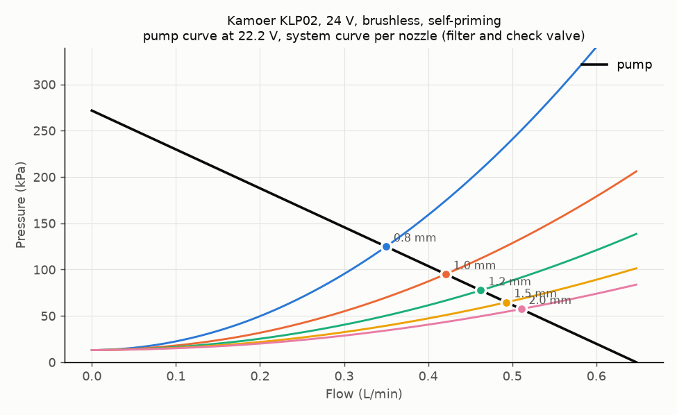
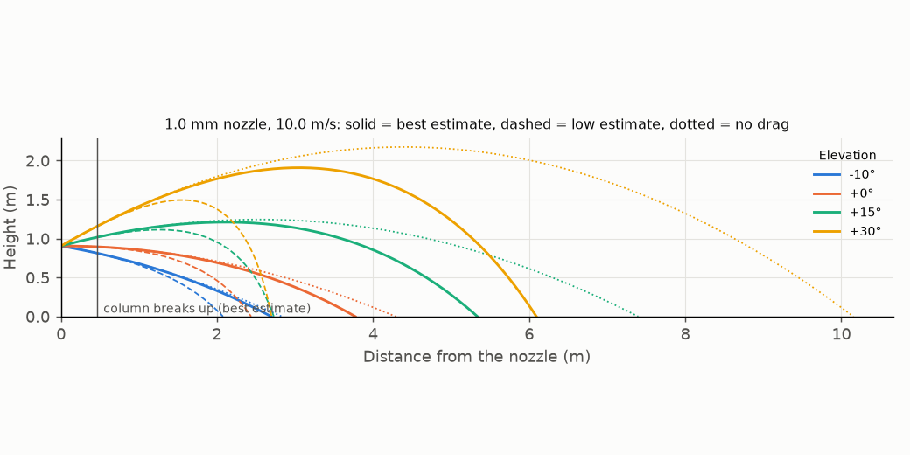

# Water system model

`water.py` computes the water system of the final design F2: the pump and system curves, the flow at each nozzle,
the jet speed, the range with air drag and jet break-up, the spray time, the recoil, and the fire size that the water can handle.
The design document with the choices, the plumbing, the safety rules and the bench tests is [docs/hardware/water.md](../../docs/hardware/water.md).

**Status:** tested in simulation. Nothing is measured. The pump values come from the Kamoer data for the KLP02 24 V.

- **Not verified:** the KLP02 pump curve is an estimate from two datasheet points: 0.7 L/min free flow and 30 m of head at zero flow.
- **Assumed:** the pump speed follows the supply voltage. The main numbers are at 22.2 V, the nominal voltage of the 6S motor bus.
- **Assumed:** the fitting losses, the nozzle coefficients (Cv 0.95, Cd 0.85) and the drag of the drop stream. Bench tests T3 and T4 measure them.

## How to run

From the repository root:

```
uv run python sim/water/water.py
```

It takes about 20 s and writes the files in `results/`. The self-check takes about 5 s:

```
uv run python sim/water/water.py check
```

The script reads the tank geometry from `cad/final/out_f2/r2.json` and uses `aim/ballistics.py` for the drag value of the aim code.

## Key results

KLP02 at 22.2 V, 1.0 mm nozzle, filter and check valve, empty tanks:

| Value | Result |
|---|---|
| Flow | 0.42 L/min (7.0 g/s) |
| Jet speed at the nozzle | 10.0 m/s (9.5 m/s at 21.0 V, 11.0 m/s at 25.2 V) |
| Range to the floor at +15°, best / low estimate | 5.3 / 2.7 m |
| Longest range (+30°), best / low estimate | 6.1 / 2.7 m |
| Spray time, 0.749 L usable | 1.8 min (107 s) |
| Recoil | 0.07 N |
| Constant drag for `aim/ballistics.py` | 0.11 1/m |
| Jet speed against the bus voltage | v0 ≈ 10.0 m/s × (V / 22.2 V)^0.8 |



Figure 1. KLP02 at 22.2 V. Each coloured curve is the system curve of one nozzle. The dots are the operating points.



Figure 2. Jet paths of the 1.0 mm nozzle at four elevations. Solid: best estimate. Dashed: low estimate. Dotted: no drag.

## Files

| File | What it is |
|---|---|
| `water.py` | The model. `PUMPS` holds the pump data and its sources. |
| [`results/water.md`](results/water.md) | All tables: every nozzle and elevation, the sensitivity cases, the fire capacity |
| `results/water.json` | The same numbers for other scripts. `docs/hardware/power_calc.py` reads the pump power from it. |
| `results/curves_KLP02.png`, `results/jets.png`, `results/ranges.png` | The figures |

`results/water.md` also has the DWP-385 gear pump as a comparison. The mission simulation still uses its jet (`sim/mission/README.md`).

## Open points

- **Open:** the DMC-101 datasheet is not available yet. If the controller holds the pump speed, the jet speed does not follow the bus voltage.
- **Open:** the jet model has no air in the lines. The two tanks share one tee, so a lean can let air in (test T8).

## Licence

Code: MIT (root `LICENSE`). This README and the result files: CC BY-SA 4.0.
