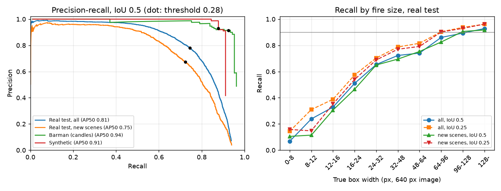

# Vision: the fire detector

This folder holds the fire detector of the robot: a YOLO11n network (Ultralytics) with one class, fire.
It finds flames in the 640 x 480 image of the Arducam B0201 camera and gives a box for each fire.
`detector.py` is the plug-in that `robot/camera_node.py` loads. It needs only onnxruntime, numpy and pillow.

**Licence:** this folder (code and model files) is AGPL-3.0 ([LICENSE](LICENSE)), because it uses Ultralytics YOLO. The code in the rest of the repository is MIT ([../LICENSE](../LICENSE)).

**Not verified:** No number here comes from the B0201 camera or from the ROCK 3C board. All test images are public photos and video frames. The RKNN model ran only in the Rockchip simulator.
**Assumed:** The B0201 has a horizontal field of view (HFOV) of 97.1° at 640 x 480 (focal length f = 283 px). `calibrate.py` will measure it.

## Status

| Part | Status |
|---|---|
| Dataset from public sources, with a data card (`data.py`, [DATA.md](DATA.md)) | built |
| YOLO11n detector, trained at 416 px (`train.py`) | built |
| Accuracy on held-out test images, CPU speed (`evaluate.py`, `export.py`, `detector.py`) | measured on laptop |
| RKNN INT8 model for the RK3566 NPU (`rknn_convert.py`) | measured on laptop, in the Rockchip simulator |
| Detector in the F2 mission simulation with real-fire flames ([sim/mission](../sim/mission/README.md)) | tested in simulation |
| Speed test for the robot board (`board_bench.py`) | built |
| Camera calibration (`calibrate.py`) | built, tested in simulation (synthetic board images) |
| Detector on the board with the B0201, indoor fire test | planned |

## Terms

- Box: the rectangle around a fire, in pixels of the 640 x 480 image. Confidence: a score from 0 to 1 for each box.
- Precision: the share of boxes that are real fires. Recall: the share of real fires that get a box.
- IoU: the overlap of two boxes, from 0 to 1. mAP50: the area under the precision-recall curve, with a match at IoU 0.5 or more.
- New scenes: test images that do not show the same scene as a training image ([DATA.md](DATA.md)). They are closer to a new room.
- NPU: the neural processing unit of the RK3566 chip. RKNN: its model format. INT8: the network computes with 8-bit integers.

## Results

The detector keeps the boxes with a confidence of 0.28 or more. This threshold gives the best balance of precision and recall on the validation images.
The full test uses the 416 x 416 export of the deployed weights. On a 640 x 480 image, it resizes the image by the same factor as the deployed file (0.65).
Sources: [metrics.md](results/all416/metrics.md) ([JSON](results/all416/metrics.json)), [speed.md](results/speed.md), [deploy_check.md](results/deploy_check.md), [video_check.md](results/video_check.md).

| Test | Result |
|---|---|
| Real test images, all (13 919 images, 8 455 fire boxes) | precision 0.781, recall 0.745, mAP50 0.809 |
| Real test images, new scenes only (5 733 images, 2 284 fire boxes) | precision 0.673, recall 0.723, mAP50 0.747 |
| Small fires (box under 32 px wide), all real test images | recall 0.472, mAP50 0.529 |
| False alarms: 330 COCO photos of fire-like things, no fire | a false box in 2.1 % of the images |
| False alarms: 4 738 new-scene images without fire | a false box in 7.4 % of the images |
| Box width for 50 % recall (IoU 0.25), distance d = f × flame width / box width, f = 283 px | 16 px: a 10 cm flame up to 1.8 m, a 30 cm flame up to 5.3 m |
| Box width for 90 % recall (IoU 0.25) | 64 px: a 10 cm flame up to 0.4 m, a 30 cm flame up to 1.3 m |
| Laptop CPU (i7-9700, onnxruntime), `detect()` on a 640 x 480 frame | 12.0 ms with 4 threads (83 frames per second), 26.7 ms with 1 thread |
| RKNN INT8 in the Rockchip simulator, 918 test images | mAP50 0.775 (ONNX on the same images: 0.816). Small-fire recall 0.500 (ONNX: 0.554) |
| 6 real videos (Wikimedia Commons, [timeline](results/video_timeline.png)) | frames with a box: candle 95 %, burning bottle 100 %, far campfire 58 %. LED candles (no fire): weak false boxes, up to 0.36 |
| F2 mission simulation, real-fire flame sprites | recall by box width as on real photos. 0.001 false boxes per image |



Left: precision-recall curves at IoU 0.5. The dot is the threshold 0.28. Right: recall by true box width.

We trained YOLO11n from the COCO weights for 20 epochs at 416 px: AdamW, learning rate 0.001, batch 64, 62 719 images per epoch ([DATA.md](DATA.md), [training curves](results/training_curves.png)).
A control run without our 203 synthetic images (`real416`) gives the same mAP50 on real photos (0.811). On the synthetic test images, it falls from 0.911 to 0.164 ([variants.md](results/variants.md)).

## Models: which file runs where

| File | Runs on | How |
|---|---|---|
| `models/fire_yolo11n_416x320.onnx` (FP32, 10.5 MB) | laptop CPU or board CPU, with onnxruntime | the default of `detector.py` |
| `models/fire_yolo11n_416x320_int8.rknn` (INT8, 3.9 MB) | RK3566 NPU, with rknn-toolkit-lite2 | `FIRE_MODEL=vision/models/fire_yolo11n_416x320_int8.rknn` |

Both files take a 416 x 320 input: a 640 x 480 camera image becomes 416 x 312 with a 4 px grey border. `aim/` then uses only the boxes from its `min_conf` (0.3 for F2, `aim/geometry.py`).

## On the robot board (RK3566)

We plan to run the INT8 model on the NPU, so that the CPU stays free for the other robot programs.
Estimate only: Rockchip gives 22.6 frames per second for YOLO11n INT8 at 640 x 640 on the RK3566, network only [1].
Our input has 0.33 times as many pixels. If the time scales with the pixels, that is about 60 frames per second. The target is 10 frames per second, the rate of `aim/`.
**Open:** "Measured on board" is still missing. `board_bench.py` is the first test on the board (about 2 minutes). Run it on the board, from the repository root.

1. When `/usr/lib/librknnrt.so` does not exist, install the NPU runtime library:

```sh
sudo curl -L -o /usr/lib/librknnrt.so https://raw.githubusercontent.com/airockchip/rknn-toolkit2/v2.5.0/rknpu2/runtime/Linux/librknn_api/aarch64/librknnrt.so
```

2. Plug in the B0201 camera. Then run the test. Without a camera, add `--video FILE`:

```sh
uv run --with rknn-toolkit-lite2==2.5.0 python vision/board_bench.py
```

3. Read the table. A model that cannot load shows "skipped" and the reason. Commit the copy that the script writes to `vision/results/board_bench_<host>.md`.

- PASS on the NPU row: use the RKNN model in the camera node (`FIRE_MODEL`, table above).
- PASS on the CPU rows only: the ONNX model on the CPU is enough, with less margin.
- FAIL on all rows: first try a lower camera rate (`[camera] fps` in `robot/config.toml`).

## Camera (Arducam B0201)

The B0201 has an M12 lens with a 120° diagonal field of view on a 16:9 sensor. The robot reads it at 640 x 480 in MJPEG.
**Assumed:** 640 x 480 is the centre 4:3 part of the sensor, and the lens is a pinhole lens. Then the HFOV is 97.1° and f = 283 px.
`robot/config.toml` (`[camera] hfov_deg`) and `aim/geometry.py` use this estimate. The real lens has strong barrel distortion.
`calibrate.py` measures the focal length, the image centre and the distortion with a printed checkerboard. Run it on the laptop, with the camera on USB.

1. Print the OpenCV checkerboard with 10 x 7 squares (9 x 6 inner corners) at 100 % scale. Glue it flat on a rigid board.
2. Measure one square. The default is 25 mm. For another size, add `--square` with the size in metres.
3. Start the live capture. With a folder of 20 to 30 photos of the board, use `--images FOLDER` instead of `--camera`:

```sh
uv run --project vision python vision/calibrate.py --camera /dev/video0
```

4. Move the board slowly: near, far, tilted up to 45°, and in all four corners of the image. The script saves one view each second, 25 views in total.
5. Read the RMS error at the end. Below 0.5 px is good. Above 0.5 px, repeat with more views near the corners.
6. Commit the output file `vision/camera_b0201.json`. When it exists, `detector.py` corrects each box for the lens distortion.
7. Put the new `hfov_deg` into `robot/config.toml` and the new intrinsics into `aim/geometry.py`.

## How to run

Run all commands from the repository root, one at a time, in this order.
`--project vision` selects the vision environment (Python 3.12, torch, Ultralytics, OpenCV). The first run installs it (about 6 GB).
Big files stay outside git: the dataset in `~/datasets/firefighter/` and the training runs in `~/runs/firefighter/vision/`.

| Step | Command | Output |
|---|---|---|
| 1. Build the dataset: 26 GB download, about 40 GB on disk, about 30 min | `uv run --project vision python vision/data.py` | `~/datasets/firefighter/yolo/`, `vision/results/data_stats.md` |
| 2. Train: NVIDIA GPU with 6 GB of memory, about 2 h on an RTX 3090 | `uv run --project vision python vision/train.py all416` | `~/runs/firefighter/vision/all416/` |
| 3. Export to ONNX, measure the CPU speed, copy the 416 x 320 model to `vision/models/` | `uv run --project vision python vision/export.py all416 --speed --install` | `vision/results/speed.md` |
| 4. Evaluate on the test images: 20 to 40 min on the CPU | `uv run --project vision python vision/evaluate.py ~/runs/firefighter/vision/all416/onnx/fire_yolo11n_416.onnx --name all416` | `vision/results/all416/` |
| 5. Convert to RKNN and run the Rockchip simulator. uv makes a separate environment for rknn-toolkit2 | `uv run --script vision/rknn_convert.py vision/models/fire_yolo11n_416x320.onnx` | `~/runs/firefighter/vision/rknn/` |
| 6. Copy the INT8 model to `vision/models/` | `cp ~/runs/firefighter/vision/rknn/fire_yolo11n_416x320_int8.rknn vision/models/` | `vision/models/` |
| 7. Compare ONNX and the RKNN simulator on the same 918 test images | `uv run --project vision python vision/evaluate.py --conf 0.28 --deploy vision/models/fire_yolo11n_416x320.onnx --rknn ~/runs/firefighter/vision/rknn/preds_fire_yolo11n_416x320_int8.npz` | `vision/results/deploy_check.md` |
| 8. Run the tests: letterbox, box decoding, detector output, lens distortion, calibration | `uv run --project vision pytest vision/test_vision.py -q` | test result |
| 9. Real fire videos. First download the clips ([video_sources.md](results/video_sources.md)) | `uv run --project vision python vision/video_demo.py` | `vision/results/video_check.md`, `video_timeline.png` |
| Camera node with this detector on a video file (root environment) | `uv run python robot/camera_node.py --source video:FILE --detector vision/detector.py` | UDP port 5600 |

## Limits and open points

- **Open:** The robot environment does not install rknn-toolkit-lite2 yet. The camera node needs it to load the RKNN model.
- **Open:** We still need the calibration of the B0201 and an indoor test with a real tray fire.
- Small fires are the weak point: under 16 px wide, the recall is under 40 %. A 640 x 480 input finds more of them (recall 0.679 against 0.554 on the 918 test images). It takes about twice the time.
- Lights can give false boxes: traffic lights, lamps and LED candles, with a confidence of 0.3 to 0.6. A screen that shows a fire also looks like a fire.
- The detector has no memory between frames. `aim/` confirms a fire over several frames.

## Licence notes

- Code and model files: GNU AGPL-3.0 ([LICENSE](LICENSE)). Datasets: [DATA.md](DATA.md) lists each source and its licence. The datasets are not in the repository.
- **Assumed:** Research and education use is allowed for all data sources. Two sources are non-commercial, so the model is not for commercial use.
- The video clips come from Wikimedia Commons ([video_sources.md](results/video_sources.md)). They are not in the repository.

## References

1. Rockchip, rknn_model_zoo, "Model performance benchmark (FPS)", README at commit 837db8e (2026-10-13). <https://github.com/airockchip/rknn_model_zoo>
2. Ultralytics YOLO11, AGPL-3.0. <https://github.com/ultralytics/ultralytics>
